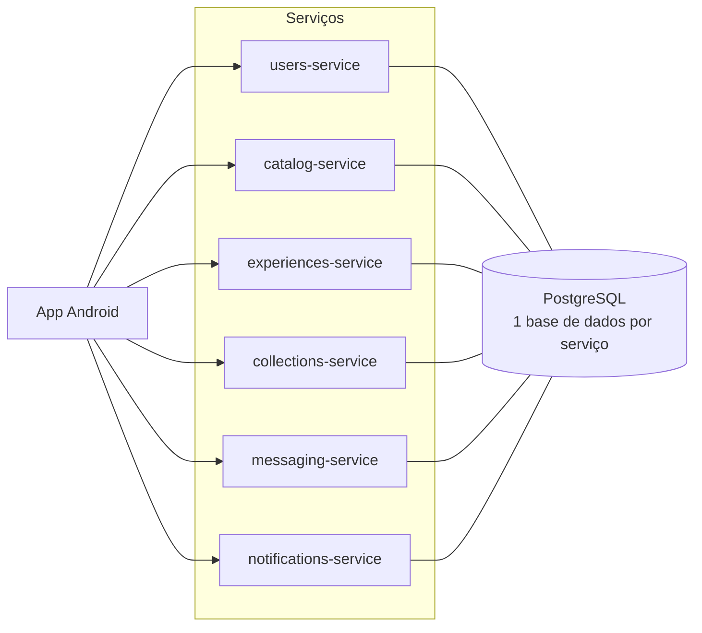
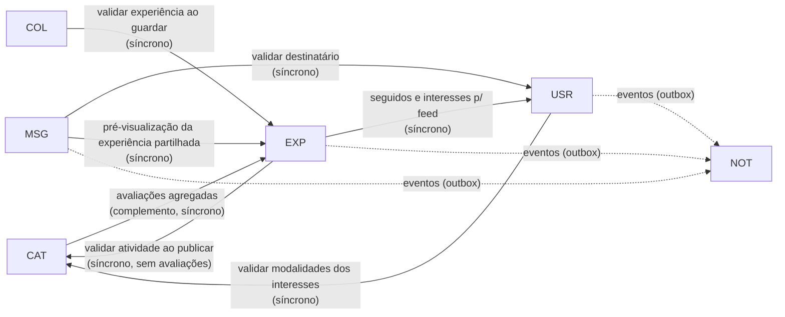

# PortoFit — Arquitetura

> Documento de desenho. Descreve o que vai ser construído e porquê; não descreve código existente.
> Estado: **proposta inicial**, a rever à medida que cada serviço for implementado.
> As escolhas tecnológicas (Kotlin/Compose/MVVM, Spring Boot, PostgreSQL, Docker Compose, REST) são decisões do grupo, não exigências confirmadas pelo docente.

## Índice

1. [Objetivo, âmbito e percursos do utilizador](#1-objetivo-âmbito-e-percursos-do-utilizador)
2. [Requisitos, funcionalidades, serviços e demonstração](#2-requisitos-funcionalidades-serviços-e-demonstração)
3. [Divisão dos serviços e responsabilidade pelos dados](#3-divisão-dos-serviços-e-responsabilidade-pelos-dados)
4. [Dependências entre serviços e comportamento perante falhas](#4-dependências-entre-serviços-e-comportamento-perante-falhas)
5. [Etapas de implementação](#5-etapas-de-implementação)
6. [Decisões e pontos em aberto](#6-decisões-e-pontos-em-aberto)

---

## 1. Objetivo, âmbito e percursos do utilizador

### 1.1 Objetivo

O PortoFit é uma comunidade para **descobrir atividades desportivas na cidade do Porto e partilhar experiências** sobre elas. Um utilizador pesquisa, por exemplo, "boxe", vê os locais que oferecem essa modalidade, abre um local e consulta as atividades disponíveis, a avaliação geral e as experiências publicadas por outras pessoas.

### 1.2 Conceitos de domínio

| Conceito | Definição | Quem o cria |
|---|---|---|
| **Modalidade** (*sport*) | Tipo de desporto: boxe, corrida, ioga, natação… Serve de categoria. | Catálogo inicial (seed) |
| **Local** (*place*) | Sítio físico no Porto onde se pratica desporto, com morada e coordenadas. | Catálogo inicial (seed) |
| **Atividade oferecida** (*offering*) | Uma modalidade praticada num local concreto (ex.: "Boxe para iniciantes" no Local X). | Catálogo inicial (seed) |
| **Experiência** (*experience*) | **Conteúdo principal.** Publicação de um utilizador sobre uma atividade oferecida: texto, fotografia e avaliação de 1 a 5 estrelas. | Utilizadores registados |
| **Gosto** | Avaliação da **publicação** por outro utilizador. | Utilizadores registados |
| **Estrelas** | Avaliação do **local/atividade** pelo autor da experiência. | Autor da experiência |
| **Lista** | Coleção com nome personalizado de experiências guardadas. | Utilizadores registados |

Relações principais:

```
Modalidade 1 ──── N Atividade oferecida N ──── 1 Local
                          │
                          1
                          │
                          N
                     Experiência ──── N Comentário
                          │      └─── N Gosto
                          │
          Lista N ──── N (referência por id)
```

Uma experiência refere-se sempre a **uma atividade oferecida**, e por isso também a um local e a uma modalidade.

### 1.3 Âmbito

**Incluído:**

- consulta e pesquisa pública de locais, modalidades, experiências e utilizadores;
- registo, autenticação, perfil (username, descrição, interesses, publicações);
- publicação de experiências com texto, estrelas e fotografia opcional (câmara dentro da app ou galeria);
- edição e remoção das próprias experiências;
- comentários, gostos, visualizações;
- categorias por modalidade e ordenação por data, avaliação e interações;
- feed de visitantes (popularidade) e feed de registados (interesses e pessoas seguidas);
- seguir utilizadores, listas personalizadas, partilha de publicações e mensagens simples;
- notificações e dashboard com estatísticas das próprias publicações;
- pesquisa por proximidade com GPS;
- degradação graciosa quando um serviço secundário falha.

**Opcional (só se houver tempo, identificado como tal na demonstração):**

- funcionamento offline (cache local de conteúdos consultados);
- adaptação da qualidade das imagens ao tipo de ligação;
- guardar **locais** em listas (além de experiências);
- associar a localização GPS à própria publicação;
- notificações *push* reais (decisão a confirmar; ver [6.2](#62-pontos-em-aberto)).

**Fora de âmbito:** reservas, pagamentos, gestão de ginásios, edição do catálogo pelos utilizadores, moderação de conteúdos, recuperação de palavra-passe, eliminação de conta.

### 1.4 Dados de demonstração

Na primeira demonstração, todos os dados pré-carregados (locais, atividades, utilizadores e experiências de exemplo) são **fictícios** e claramente identificados como tal:

- os locais têm nomes inventados e o campo `demo: true`; a app mostra a indicação "Dados de demonstração";
- os utilizadores de exemplo usam o prefixo `demo_` no username;
- as coordenadas ficam dentro do Porto para a pesquisa por proximidade ser realista, mas não correspondem a estabelecimentos reais.

Isto evita atribuir avaliações inventadas a negócios reais. Usar espaços reais (ex.: parques públicos) pode ser reconsiderado depois da primeira demonstração.

### 1.5 Percursos principais

**P1 — Visitante descobre uma atividade (sem conta)**
1. Abre a app e vê o feed de visitantes (experiências populares).
2. Pesquisa "boxe" e obtém locais, experiências e utilizadores relacionados.
3. Filtra por proximidade (opcional, com permissão de localização).
4. Abre um local: vê atividades oferecidas, avaliação geral e experiências publicadas.
5. Tenta dar um gosto → é convidado a iniciar sessão.

**P2 — Registo e personalização**
1. Cria conta (username, email, palavra-passe).
2. Escolhe interesses (modalidades) e escreve uma descrição.
3. Segue outros utilizadores; o feed passa a mostrar experiências das pessoas seguidas e das modalidades de interesse.

**P3 — Publicar uma experiência**
1. A partir de um local, escolhe a atividade oferecida e toca em "Partilhar experiência".
2. Opcionalmente, tira uma fotografia **com a câmara dentro da app** ou escolhe uma da galeria.
3. Escreve o texto, atribui 1–5 estrelas e publica.
4. A experiência aparece no local e no perfil; a avaliação geral do local é recalculada.

**P4 — Interagir**
1. Abre uma experiência (conta como visualização), dá gosto e comenta.
2. Guarda-a numa lista ("Para experimentar").
3. Partilha-a com outro utilizador por mensagem.
4. O autor recebe notificações do gosto, do comentário e da partilha.

**P5 — Acompanhar o próprio desempenho**
1. Abre o dashboard e vê, por publicação, visualizações, gostos, comentários e número de vezes guardada.

---

## 2. Requisitos, funcionalidades, serviços e demonstração

Legenda dos serviços: **USR** users · **CAT** catalog · **EXP** experiences · **COL** collections · **MSG** messaging · **NOT** notifications.

| # | Requisito | Funcionalidades | Serviço(s) | Critério de demonstração |
|---|---|---|---|---|
| R1 | Visitantes consultam e pesquisam conteúdos e utilizadores | Pesquisa unificada (locais, experiências, utilizadores) sem sessão; detalhe de local, experiência e perfil | CAT, EXP, USR | Sem sessão iniciada, pesquisar "boxe" mostra locais e experiências; pesquisar um username mostra o perfil |
| R2 | Perfil com username, descrição, interesses e publicações | Registo, login, editar descrição e interesses, ver publicações do utilizador | USR (perfil), EXP (publicações), CAT (lista de modalidades) | Criar conta, editar perfil, sair e voltar a entrar: dados persistem; o perfil lista as publicações |
| R3 | Publicar experiência com texto, fotografia e 1–5 estrelas | Formulário de publicação a partir de uma atividade oferecida; fotografia opcional; editar e apagar a própria | EXP (valida a atividade em CAT) | Publicar uma experiência com fotografia e outra sem; ambas aparecem no local e no perfil; estrelas fora de 1–5 são rejeitadas |
| R4 | Câmara dentro da app e galeria | Captura pela aplicação de câmara do sistema a partir do ecrã de publicação (sem CameraX); seleção com Photo Picker | App, EXP (armazenamento) | **Obrigatório na demonstração:** tirar fotografia com a câmara dentro da app e publicá-la; repetir escolhendo da galeria |
| R5 | Comentários e gostos; gostos avaliam a publicação, estrelas avaliam o local/atividade | Comentar, dar/retirar gosto; contadores separados de gostos e estrelas | EXP | Gostos alteram o contador da publicação mas **não** a avaliação do local; nova experiência altera a avaliação do local |
| R6 | Categorias por modalidade e ordenação por data, avaliação e interações | Filtro por modalidade; ordenação `recent`, `likes`, `interactions`, `stars` disponível também a visitantes | EXP, CAT | Sem sessão, a mesma lista ordenada por data, gostos, interações e estrelas produz ordens diferentes e explicáveis; fica claro que gostos avaliam a publicação e estrelas o local/atividade (ver [3.6](#36-métricas-e-ordenações)) |
| R7 | Feed de visitantes por popularidade; feed de registados por interesses e seguidos | `GET /feed/popular` e `GET /feed` | EXP (consulta USR) | Visitante vê feed popular; após seguir alguém e escolher interesses, o feed muda |
| R8 | Listas com nomes personalizados e conteúdos guardados | Criar/renomear/apagar listas; adicionar/remover experiências | COL (consulta EXP) | Criar a lista "Para experimentar", guardar duas experiências, reabrir a app: continuam lá |
| R9 | Seguir, partilhar publicações e mensagens simples | Seguir/deixar de seguir; conversas 1-para-1 atualizadas por consulta periódica; mensagem com referência a experiência | USR, MSG | Utilizador A segue B e partilha uma experiência; B vê a mensagem com a pré-visualização da experiência (por consulta periódica, com atraso variável, não em tempo real) |
| R10 | Notificações | Lista de notificações; notificação Android do sistema | NOT (eventos de USR, EXP, MSG) | Gosto de A numa experiência de B gera notificação para B, visível na app; na barra do Android aparece na consulta periódica seguinte, com atraso (sem push) |
| R11 | Dashboard das próprias publicações | Estatísticas por publicação e totais | EXP (+ COL para "guardada") | Dashboard mostra visualizações, gostos, comentários e vezes guardada; números batem com as ações feitas |
| R12 | GPS e pesquisa por proximidade | Pedir permissão, obter posição, pesquisar por raio | App, CAT | Com localização simulada no emulador, os locais aparecem ordenados por distância com distância em km |
| R13 | Microserviços com dados e APIs próprios, Docker e Docker Compose | 6 serviços Spring Boot, cada um com base de dados própria | Todos | `docker compose up` arranca tudo; cada serviço responde em `/actuator/health`; nenhum acede às tabelas de outro |
| R14 | Degradação graciosa | Timeouts, estados "indisponível", fila de eventos (outbox) | Todos + App | Parar NOT, COL e MSG com `docker compose stop`: pesquisar, consultar e publicar continuam a funcionar (ver [4.4](#44-guião-de-demonstração-de-falhas)) |
| R15 | Offline e adaptação de imagens (opcionais) | Cache local; miniaturas para ligações lentas | App, EXP | Só se implementado: modo de avião mostra conteúdos já vistos |
| R16 | Sem reservas, pagamentos ou gestão de ginásios | — | — | O catálogo só tem informação descritiva (horários como texto informativo) |

---

## 3. Divisão dos serviços e responsabilidade pelos dados

### 3.1 Visão geral



Sem API gateway nesta fase: a app conhece o endereço de cada serviço (configurado num único sítio da app). Um gateway pode ser acrescentado mais tarde sem alterar os serviços.

### 3.2 Responsabilidades

| Serviço | Responsabilidade | Dados que controla | Público (sem sessão) | Exige sessão |
|---|---|---|---|---|
| **users-service** | Registo, autenticação (emissão de tokens), perfis, interesses, seguir | utilizadores, credenciais (hash), interesses (ids de modalidade), relações de seguir | ver perfil, pesquisar utilizadores, listas de seguidores/seguidos | editar perfil, seguir |
| **catalog-service** | Modalidades, locais, atividades oferecidas, pesquisa por nome/modalidade/proximidade | modalidades, locais, atividades oferecidas | tudo (só leitura) | — (sem escrita nesta fase) |
| **experiences-service** | Experiências, fotografias, estrelas, comentários, gostos, visualizações, avaliações agregadas, feeds, estatísticas | experiências, ficheiros de fotografia, comentários, gostos, visualizações | ler, pesquisar, feed popular, avaliações agregadas | publicar, apagar a própria, comentar, gostar, feed pessoal, dashboard |
| **collections-service** ([collections-api.md](collections-api.md)) | Listas personalizadas e referências a conteúdos guardados | listas, itens (id da experiência) | contagem de vezes guardada (agregada) | tudo o resto (listas são privadas) |
| **messaging-service** ([messaging-api.md](messaging-api.md)) | Conversas 1-para-1, mensagens, partilha de experiências; a app obtém mensagens novas por consulta periódica (sem tempo real na primeira versão) | conversas, mensagens (texto e/ou id de experiência) | — | tudo |
| **notifications-service** | Registo, consulta e marcação de notificações | notificações, ids de eventos já processados | — | consultar e marcar como lidas |

**Pesquisa textual (todos os serviços com pesquisa: CAT, EXP, USR).** Comportamento pretendido: correspondência parcial que **ignora maiúsculas/minúsculas e acentos** — `boxe`, `BOXE` e `Boxe` dão o mesmo resultado, e `natacao` encontra "Natação". A forma de implementar (função de base de dados, coluna normalizada guardada pelo serviço, ou outra) é escolhida na implementação de cada serviço, desde que cumpra este comportamento.

### 3.3 Ajustes à divisão inicial

A divisão proposta mantém-se, com estes ajustes e esclarecimentos:

1. **A partilha é uma mensagem.** Partilhar uma experiência cria, no messaging-service, uma mensagem com `experienceId`. Não há um serviço ou entidade "partilha" separada.
2. **As avaliações agregadas são do experiences-service, não do catálogo.** As estrelas vivem nas experiências; o catálogo pede o agregado e mostra-o como complemento opcional (ver [catalog-api.md](catalog-api.md)).
3. **As fotografias ficam no experiences-service** (volume Docker), sem serviço de média próprio. Simplifica; a contrapartida é este serviço ficar maior.
4. **A pesquisa unificada é composta na app**: a app faz três pedidos em paralelo (CAT, EXP, USR) e mostra cada secção de forma independente. Não há serviço de pesquisa.
5. **O dashboard é composto na app**: métricas próprias vêm do EXP; "vezes guardada" vem do COL. Se o COL falhar, essa coluna aparece como indisponível.
6. **Os interesses guardam ids de modalidade do catálogo** (`"boxe"`, `"corrida"`), por isso os ids de modalidade são *slugs* estáveis.
7. **Utilizadores referenciados por `userId`.** Todas as referências a utilizadores entre serviços (autor, seguidor, destinatário, dono de lista) usam o `userId` (UUID gerado pelo users-service e nunca alterado). O username é apenas um dado de apresentação; as cópias que outros serviços guardam (ver [3.5](#35-cópias-de-dados-desnormalização)) nunca são usadas para identificar, autorizar ou relacionar dados.
8. **O notifications-service não decide destinatários.** Quem produz o evento (EXP, USR, MSG) já sabe quem deve ser notificado e envia-o no evento.

### 3.4 Isolamento dos dados

- Cada serviço tem **a sua base de dados e as suas credenciais**. Nenhum serviço lê ou escreve tabelas de outro; quando precisa de dados alheios, chama a API REST do dono.
- Referências entre serviços são **ids estáveis** (ex.: a experiência guarda `offeringId` e `authorId`, que é o `userId` do autor). Não há chaves estrangeiras entre bases de dados; a validação é feita pela API no momento da escrita.
- Cada serviço gere o seu esquema com migrações próprias (ex.: Flyway).

**Em desenvolvimento usa-se uma única instância PostgreSQL** com seis bases de dados (`users_db`, `catalog_db`, …) e seis utilizadores, cada um só com permissões na sua base. Isto mantém o isolamento lógico e poupa memória, mas **é um ponto comum de falha**: se o contentor PostgreSQL parar, todos os serviços perdem a persistência ao mesmo tempo. A degradação graciosa demonstrada é, por isso, entre serviços aplicacionais, não ao nível da base de dados. Numa instalação real usar-se-ia uma instância por serviço (ou um serviço gerido com alta disponibilidade); a mudança é só de configuração (URL de ligação), porque nenhum serviço depende de estar na mesma instância.

### 3.5 Cópias de dados (desnormalização)

Para que os serviços continuem a responder quando outros falham, alguns dados são **copiados no momento da escrita**. Distinguem-se dois tipos de campo:

- **Referência** (id estável): identifica a entidade, é usada em filtros, autorização e relações. Nunca fica errada.
- **Cópia de apresentação**: só serve para mostrar algo sem chamar outro serviço. Pode ficar desatualizada; isso afeta o que se vê, nunca a quem pertencem os dados.

| Serviço | Referência guardada | Cópia de apresentação | Origem da cópia |
|---|---|---|---|
| EXP | `authorId`, `offeringId`, `placeId`, `sportId` | username do autor; nome do local, da atividade e da modalidade; indicação de local fictício | token do autor; CAT ao publicar ([experiences-api.md §2](experiences-api.md#2-entidades-e-responsabilidade-pelos-dados)) |
| MSG | participantes e `senderId` (`userId`), `experienceId` | usernames dos dois participantes; **nada da experiência** (consultada em lote ao mostrar, [messaging-api.md §7](messaging-api.md#7-partilha-de-experiências)) | token e USR ao criar a conversa |
| COL | `ownerId`, `experienceId` | — | — |
| NOT | `recipientId`, `actorId`, id do objeto | texto da notificação | evento |

`placeId` e `sportId` no EXP são referências copiadas do catálogo ao publicar, para permitir filtrar por modalidade e por local sem chamar o CAT.

Consequências e limitações:
- Se um utilizador mudasse de username, as cópias antigas mostrariam o nome anterior, mas continuariam ligadas à pessoa certa pelo `userId`. Nesta fase o username não é editável (simplifica a interface e a demonstração); se passar a ser, o ecrã pode obter os usernames atuais ao USR por `userId` e usar a cópia apenas quando o USR estiver indisponível.
- Se um local mudar de nome no catálogo, experiências antigas mostram o nome antigo. Como o catálogo é estático nesta fase, o risco é baixo; a correção seguiria o mesmo princípio (consultar o dono pelo id).

### 3.6 Métricas e ordenações

As métricas são **distintas** e nunca se misturam:

| Métrica | O que avalia | Quem a define |
|---|---|---|
| **Estrelas** (1–5) | O **local/atividade**, na opinião do autor | Autor da experiência |
| **Avaliação geral** do local/atividade | O **local/atividade**: média das estrelas com regras anti-distorção ([3.7](#37-avaliação-geral-sem-distorção)) | Calculada no EXP |
| **Gostos** | A **publicação** | Outros utilizadores |
| **Comentários** | A **publicação** (participação) | Outros utilizadores |
| **Interações** | A **publicação**: `gostos + comentários` | Calculada no EXP |
| **Visualizações** | Alcance da publicação: aberturas do detalhe, registadas pela app com um pedido próprio, no máximo uma por pessoa em cada período fixo de 24 h e sem contar o autor (regras em [experiences-api.md §13](experiences-api.md#13-etapa-e3-comentários-gostos-e-visualizações)) | Calculada no EXP; só usada no dashboard |

Ordenações de listas de experiências (`sort`), **disponíveis a todos, incluindo visitantes sem sessão**, em qualquer lista de experiências (de um local, de uma atividade, de uma modalidade, de um perfil ou de uma pesquisa):

| Valor | Ordena por | O que significa para quem vê | Desempate |
|---|---|---|---|
| `recent` (por omissão) | data de publicação, mais recente primeiro | o mais novo | id |
| `likes` | número de gostos, maior primeiro | as **publicações** mais apreciadas | data |
| `interactions` | gostos + comentários, maior primeiro | as **publicações** com mais atividade | data |
| `stars` | estrelas que o autor deu ao local/atividade, maior primeiro | as opiniões mais positivas **sobre o local/atividade** (não sobre a publicação) | data |

Na app, as opções aparecem com nomes que tornam a diferença explícita: "Mais recentes", "Mais gostadas", "Mais interações", "Melhor avaliação do local". As estrelas mostram-se como ★ junto ao local/atividade; os gostos como ♥ junto à publicação.

A "data" de publicação é sempre a data de criação; editar uma experiência não a faz subir na ordenação `recent`.

As visualizações ficam fora das interações porque são fáceis de inflacionar (basta abrir) e não exprimem opinião.

### 3.7 Avaliação geral sem distorção

Problema: a mesma pessoa pode publicar várias experiências sobre a mesma atividade e, sem regra, teria mais peso na média.

**Princípio: cada pessoa tem peso 1 — uma vez por atividade e uma vez por local.**

**Definições**

1. **Avaliação vigente** de uma pessoa P para uma atividade oferecida A: as estrelas da experiência **não apagada** de P sobre A com a **data de criação mais recente**; se duas tiverem exatamente a mesma data, conta a de `id` maior (UUID versão 7 gerado pelo servidor, comparado byte a byte; ver [experiences-api.md §7.2](experiences-api.md#72-desempate-determinístico)). As outras experiências de P sobre A continuam visíveis, mas não contam para a média.
2. **Avaliação de uma atividade oferecida** A = média aritmética das avaliações vigentes de todas as pessoas que têm avaliação vigente em A. `ratingsCount` = número dessas pessoas.
3. **Contribuição de uma pessoa** P para um local L = média aritmética das avaliações vigentes de P nas atividades de L em que P tem avaliação vigente.
4. **Avaliação geral de um local** L = média aritmética das contribuições de todas as pessoas com pelo menos uma avaliação vigente em L. `ratingsCount` = número de pessoas distintas.
5. Os valores são calculados sem arredondamentos intermédios; arredondam-se a **uma casa decimal só na resposta** (meio para cima).
6. Sem nenhuma avaliação vigente → estado "sem avaliações", **nunca** 0 estrelas.

**Edição e remoção**

| Ação do autor | Efeito na avaliação |
|---|---|
| Edita o texto ou a fotografia | Nenhum |
| Edita as estrelas da sua experiência **vigente** em A | A nova classificação substitui a anterior de imediato (na atividade e no local) |
| Edita as estrelas de uma experiência **mais antiga** sobre A | Nenhum enquanto existir uma mais recente; o valor editado volta a contar se a mais recente for apagada |
| Quer mudar a atividade a que a experiência se refere | Não é permitido editar; apaga e publica uma nova |
| Apaga a experiência vigente em A | Passa a contar a experiência anterior mais recente de P sobre A, se existir; senão, P deixa de contar em A (e no local, se não tiver outras atividades avaliadas lá) |
| Apaga uma experiência que não é a vigente | Nenhum |

A data usada para escolher a vigente é sempre a de criação: editar uma experiência antiga não a torna vigente. As avaliações são calculadas a partir dos dados atuais em cada pedido, pelo que qualquer edição ou remoção se reflete no pedido seguinte.

**Exemplo** (local "Clube X" com as atividades Boxe e Ioga)

| Pessoa | Experiências (por ordem de criação) | Vigente Boxe | Vigente Ioga | Contribuição para o local |
|---|---|---|---|---|
| Ana | Boxe 5★, Boxe 3★, Ioga 4★ | 3 | 4 | (3 + 4) / 2 = 3,5 |
| Rui | Boxe 4★ | 4 | — | 4 |
| Eva | Ioga 2★ | — | 2 | 2 |

- Boxe = (3 + 4) / 2 = **3,5** (2 pessoas) — não (5 + 3 + 4) / 3 = 4,0.
- Ioga = (4 + 2) / 2 = **3,0** (2 pessoas).
- Local = (3,5 + 4 + 2) / 3 = **3,2** (3 pessoas) — Ana conta uma vez, embora tenha avaliado duas atividades.
- Se Ana apagar a experiência "Boxe 3★", a vigente dela no Boxe passa a 5: Boxe = 4,5; contribuição de Ana = 4,5; local = (4,5 + 4 + 2) / 3 = 3,5.

Consequência visível: a avaliação do local não é a média das avaliações das atividades, e o número de pessoas do local pode ser menor do que a soma das pessoas de cada atividade.

Os gostos **não** entram nesta conta.

### 3.8 Autenticação e autorização

- **Leituras públicas:** pesquisa e consulta de locais, modalidades, experiências, comentários, perfis e avaliações não exigem sessão (requisito R1).
- **Escritas exigem sessão:** publicar, comentar, gostar, seguir, editar perfil, listas, mensagens, notificações e dashboard.
- O **users-service** autentica (email + palavra-passe guardada com hash BCrypt) e emite um **access token JWT** assinado com chave privada RSA (RS256), com `sub` (id do utilizador), `username`, emissor e destinatário, e validade de 15 min. A sessão é renovada com um **refresh token** opaco, com rotação a cada uso, prazo máximo de 30 dias por sessão e revogação no logout. Detalhes em [users-api.md](users-api.md).
- Os outros serviços **validam o token localmente** com a chave pública (configurada no arranque) — assinatura, emissor, destinatário e expiração — sem chamar o users-service em cada pedido.
- **Autorização por dono:** só o autor edita ou apaga a sua experiência ou comentário; só o dono vê e altera as suas listas, conversas e notificações. O `userId` vem sempre do token, nunca do corpo do pedido.
- **Endpoints internos** (chamados apenas entre serviços, prefixo `/internal`) são protegidos por uma chave partilhada por serviço, definida em variáveis de ambiente do Docker Compose.

**Limites da validação local quando o users-service falha**

A validação local evita que o users-service seja chamado em todas as escritas, mas **não torna as escritas independentes dele**:

- **Tokens expiram.** Um access token válido continua a ser aceite até expirar; depois disso, a app tem de o renovar com o refresh token, e isso exige o users-service. Uma falha mais longa do que a validade restante do access token impede essa pessoa de escrever (a sessão não se perde: volta a funcionar quando o users-service regressar, se o refresh token ainda for válido).
- **Renovar ou obter sessão depende do users-service.** Login, registo e renovação ficam indisponíveis durante a falha; quem não tem sessão fica limitado às leituras públicas.
- **Algumas operações precisam de dados do users-service**, mesmo com token válido: seguir alguém, editar perfil e interesses, iniciar uma conversa nova (validar o destinatário), o feed personalizado (seguidos e interesses) e mostrar perfis ou usernames atualizados.
- **Operações que tipicamente continuam** com token ainda válido: publicar, editar e apagar experiências, comentar, gostar e gerir listas — desde que os serviços que essas operações usam (EXP, CAT para publicar, COL) estejam disponíveis.
- **O access token não reflete alterações posteriores** à sua emissão (ex.: logout ou conta desativada): continua aceite até expirar, porque só os refresh tokens são revogáveis.

Limitações aceites nesta fase: access tokens não revogáveis antes de expirar, HTTP sem TLS em desenvolvimento (a app só permite tráfego em claro para o endereço local do emulador). A validade do access token é um compromisso: mais longa melhora a tolerância a falhas do users-service, mais curta torna o logout e a revogação mais eficazes.

### 3.9 Fotografias e câmara

- **Câmara a partir da app:** Captura pela **aplicação de câmara do sistema**, chamada a partir do ecrã de publicação (Activity Result API `TakePicture`, com uma URI do FileProvider: fotografia em resolução completa, não a miniatura). Não exige a permissão `CAMERA` nem CameraX; a captura começa no percurso de publicação e o resultado volta ao formulário. Sem aplicação de câmara (ou se for cancelada), a galeria e a publicação sem fotografia continuam disponíveis. Decisão da etapa 7: a aplicação do sistema chega para o requisito R4 e evita uma dependência e uma permissão a mais ([app-android.md §15](app-android.md#15-fotografias-etapa-7-e2)).
- **Galeria:** Android Photo Picker, que não exige permissão de armazenamento.
- A app **reduz a imagem antes de enviar** (ex.: lado maior até ~1600 px, JPEG) para limitar dados móveis e tempo de upload.
- Upload em dois passos: `POST /media` devolve um `mediaId`; `POST /experiences` referencia-o. Se o upload falhar, o texto e as estrelas ficam no ecrã para nova tentativa. Fotografias carregadas mas nunca usadas são apagadas por uma tarefa periódica.
- **Fotografia opcional, no máximo uma por experiência.** Uma experiência pode ser publicada só com texto e estrelas (por exemplo, se o upload falhar). A captura pela câmara dentro da app tem de estar sempre disponível no ecrã de publicação e faz parte obrigatória da demonstração (R4).
- No servidor, a imagem é validada pelo conteúdo real e recodificada (orientação aplicada, metadados como a localização GPS removidos), com nomes gerados pelo servidor e guardada num volume próprio. Detalhes, limites e falhas parciais em [experiences-api.md §12](experiences-api.md#12-etapa-e2-fotografias).
- *Opcional:* gerar miniaturas e a app escolher a resolução conforme a ligação (Wi-Fi vs. dados móveis).

### 3.10 Feeds

Contrato completo em [experiences-api.md §14](experiences-api.md#14-etapa-e4-feeds-e-dashboard) (revisto em 2026-10-19).

**Feed popular (`GET /feed/popular`, público):** interações (gostos + comentários ativos) em dois blocos. Primeiro as publicadas desde o início do dia UTC de há 30 dias, depois as restantes. Em cada bloco: interações, data e `id`, decrescentes. Regra simples, explícita e determinística; o período evita que publicações antigas fiquem eternamente no topo, e o segundo bloco evita listas vazias.

**Feed pessoal (`GET /feed`, com sessão):**
1. O EXP pede ao USR o contexto **do utilizador do token** (`GET /internal/me/feed-context`, com o token reencaminhado e a chave interna; só ids de seguidos e de modalidades).
2. Seleciona experiências de pessoas seguidas **ou** de modalidades de interesse, excluindo as do próprio, por data (mais recentes primeiro), indicando em cada uma porque aparece.
3. Sem seguidos nem interesses → feed popular com `mode: POPULAR` (`NO_PREFERENCES`); conjunto pessoal filtrado vazio (decidido pelo total, não pela página) → idem (`NO_MATCHES`).
4. **Se o USR não responder** (0,5 s de ligação, 1 s de resposta, sem novas tentativas) ou recusar a chave interna, devolve o feed popular com `mode: POPULAR_FALLBACK`, e a app mostra "Não foi possível personalizar agora; a mostrar publicações populares". Se o USR recusar o token, a resposta é `401`. Nunca apresenta resultados populares como personalizados; se o modo mudar entre páginas, a app recomeça a lista.
5. Cada pessoa segue no máximo 500 outras (limite aplicado ao seguir), por isso o contexto é sempre completo.

Os feeds não consultam o catálogo: usam os nomes copiados na publicação e mantêm as experiências de atividades retiradas como registo histórico. **Modo de demonstração:** enquanto só houver o catálogo fictício, os feeds incluem as publicações de locais de demonstração. Quando o catálogo real entrar, ficam fora dos feeds, acessíveis pelo perfil, pelo local e por referência direta ([experiences-api.md §14.6](experiences-api.md#146-modo-de-demonstração-e-catálogo-real)).

### 3.11 Notificações

**Objetivo:** o utilizador vê as notificações dentro da app **e** como notificações Android do sistema.

**Tipos:** novo seguidor, gosto, comentário, experiência partilhada consigo, nova mensagem.

**Passagem de eventos entre serviços — solução planeada: *transactional outbox***

Esta solução só é implementada na etapa das notificações ([etapa 10](#5-etapas-de-implementação)). Até lá, os serviços não produzem eventos e não há notificações. O objetivo é evitar o "dispara e esquece" (enviar um pedido e ignorar o resultado), em que uma falha do notifications-service fazia perder o evento sem ninguém saber.

1. **Registo na mesma transação.** Quando acontece algo notificável (ex.: um gosto), o serviço produtor grava, **na mesma transação da base de dados**, o gosto e uma linha na sua tabela `outbox`: id único do evento (UUID), tipo, `recipientId`, `actorId`, dados, data de criação, estado (`PENDING`), número de tentativas e data da próxima tentativa. Ou ficam gravados os dois, ou nenhum.
2. **Envio por tarefa agendada.** Uma tarefa no produtor (ex.: a cada 5 segundos) envia, por ordem de criação, os eventos `PENDING` cuja data da próxima tentativa já passou (`POST /internal/events`), e marca-os `SENT` quando recebe resposta de sucesso.
3. **Tentativas com intervalo crescente.** Em caso de erro ou timeout, incrementa as tentativas e adia a próxima com intervalo crescente (ex.: 5 s, 10 s, 20 s, 40 s… até um máximo de 10 minutos entre tentativas).
4. **Falha persistente.** Ao fim de um número máximo de tentativas (ex.: 20, que cobre várias horas), o evento passa a `FAILED`, é registado em log e **fica guardado** na tabela; não é apagado. Pode ser reenviado manualmente (repondo-o em `PENDING`) depois de corrigida a causa. Erros que nunca vão resultar (ex.: resposta 400, evento mal formado) passam logo a `FAILED` sem gastar tentativas.
5. **Deduplicação.** O notifications-service guarda o id de cada evento recebido com uma restrição de unicidade; um evento repetido é respondido com sucesso e ignorado. Isto torna seguro reenviar quando a resposta anterior se perdeu (ex.: o NOT gravou o evento mas o produtor não recebeu a confirmação).
6. **Limpeza.** Eventos `SENT` são apagados após alguns dias.

O que esta solução oferece, e o que não oferece:
- **Falhas de notificações não impedem publicar, gostar, comentar, seguir nem enviar mensagens.** O efeito é apenas atrasar as notificações.
- Entrega **pelo menos uma vez** enquanto o evento estiver em `PENDING`, com deduplicação no destino para que o utilizador não veja duplicados. **Não é uma garantia absoluta**: um evento pode acabar em `FAILED` se a falha durar mais do que as tentativas configuradas, e perde-se se a base de dados do produtor for perdida antes do envio.
- **A ordem não é garantida** entre produtores diferentes (ex.: a notificação de um comentário pode chegar antes da de um gosto feito antes).
- Atraso esperado em funcionamento normal: alguns segundos; durante uma falha, até ao fim da falha mais o intervalo da tentativa seguinte.
- Custo: a tabela `outbox` e a tarefa de envio repetem-se em USR, EXP e MSG. É pouco código e é o mesmo nos três.
- *Retirar um gosto* não apaga a notificação já criada (simplificação aceite).

**Entrega ao Android (primeira versão, sem *push*)**
- **Com a app aberta:** consulta o número de notificações não lidas periodicamente (ex.: a cada 30 segundos) e ao voltar ao primeiro plano.
- **Com a app fechada:** uma tarefa periódica do WorkManager consulta notificações novas e mostra-as como notificações do sistema. O WorkManager **não dá notificações imediatas**:
  - o intervalo mínimo de uma tarefa periódica é de 15 minutos;
  - o Android pode adiar a execução bastante mais (modo Doze, *App Standby Buckets*, poupança de bateria, restrições do fabricante);
  - a tarefa só corre com rede (restrição definida pela app), pelo que sem ligação não há verificação;
  - o momento exato não é garantido.
- Exige a permissão `POST_NOTIFICATIONS` (Android 13+); se recusada, as notificações continuam visíveis dentro da app.
- Na demonstração, a notificação na barra do Android aparece com atraso; pode forçar-se a execução da tarefa para mostrar o mecanismo, explicando que em uso real o atraso é variável.

**Push real (Firebase Cloud Messaging) — decisão a confirmar.** Seria a forma de ter notificações quase imediatas com a app fechada, mas exige projeto Firebase, `google-services.json`, registo do token do dispositivo e um passo extra no notifications-service. O desenho acima permite acrescentá-lo sem mudar os produtores de eventos.

### 3.12 Dashboard

Só para o próprio utilizador (o autor é o `sub` do token). Contrato em [experiences-api.md §14.4](experiences-api.md#144-dashboard-get-mestats-e-get-mestatsexperiences).

- **Endpoints:** `GET /me/stats` devolve os totais **recebidos** (gostos, comentários incluindo os do próprio autor, visualizações), as publicações ativas criadas no período e, à parte, o **histograma das estrelas que o autor deu aos locais/atividades** nas publicações ativas criadas no período. Não são notas recebidas pela publicação. `GET /me/stats/experiences` devolve as métricas por publicação, paginadas.
- **Períodos:** "Sempre", 7 ou 30 dias, em dias UTC, com `from`, `to` e `generatedAt` na resposta. As publicações e o histograma contam pela data de criação; gostos e comentários pela data da interação (uma interação recente numa publicação antiga conta no período recente); as visualizações pelo dia UTC em que foram contadas.
- **Estado atual:** publicações eliminadas, gostos retirados e comentários eliminados deixam de contar.
- **Falha:** dá `503`, e a app mostra "indisponível", nunca zeros.

A app junta mais tarde "vezes guardada" com `GET /stats/saves?experienceIds=…` (COL). Partilhas por mensagem não entram nesta fase (exigiria contagens do MSG; pode ser acrescentado da mesma forma).

Visualizações (apresentadas como **soma**, não como pessoas únicas): no máximo uma por pessoa (ou por chave de instalação, para visitantes; nunca pelo IP) em cada período fixo de 24 h (dia UTC), sem contar o autor ([experiences-api.md §13.5](experiences-api.md#135-visualizações)). É uma métrica aproximada e manipulável, que não mede pessoas únicas: apagar os dados da app, enviar chaves novas ou alternar entre visitante e sessão conta de novo.

### 3.13 Estrutura da app

Um único módulo Android, MVVM, organizado por funcionalidade:

```
com.example.portofit/
├── PortoFitApp.kt            Application; cria o AppContainer
├── di/AppContainer.kt        injeção de dependências manual
├── data/
│   ├── remote/               clientes REST e DTOs, um por serviço
│   ├── repository/           um repositório por área; devolve sucesso ou erro tipificado
│   └── model/                modelos usados pela UI
└── ui/
    ├── navigation/           rotas e NavHost
    ├── theme/                tema Material 3
    ├── components/           composables reutilizáveis
    └── feature/<área>/       <Área>Screen.kt, <Área>ViewModel.kt, <Área>UiState.kt
```

- Cada ecrã tem um `UiState` com estados por secção (a carregar, dados, vazio, indisponível), para que a falha de uma secção não esconda as outras.
- Todos os textos visíveis em `strings.xml`, em português.
- Os endereços dos serviços ficam num único sítio de configuração (no emulador, o computador é `10.0.2.2`).
- **Navegação a partir da E4 (decidida):** **Pesquisar** (locais e pessoas, o ecrã atual) continua a ser o destino inicial; uma barra inferior acrescenta **Descobrir** (feed) e **Estatísticas** (dashboard; sem sessão, convite para entrar). Cada destino mantém o seu estado; os detalhes empilham-se por cima; o menu de conta continua na barra superior ([experiences-api.md §14.7](experiences-api.md#147-app-android-descobrir-e-estatísticas-proposta-para-a-etapa-da-app)).

### 3.14 Opcionais

- **Offline:** cache local (Room) das últimas experiências e locais consultados; mostrar com indicação "sem ligação". Escritas offline ficam fora.
- **Imagens adaptadas à ligação:** miniaturas geradas no EXP; a app escolhe o tamanho conforme a ligação.

Ambos só são feitos depois de todos os requisitos obrigatórios estarem demonstráveis.

---

## 4. Dependências entre serviços e comportamento perante falhas

### 4.1 Princípios

1. **Leituras do próprio serviço nunca dependem de outro serviço.** Um serviço responde sempre com os dados que controla.
2. **Chamadas síncronas entre serviços têm timeout curto** (ligação ~0,5 s, resposta ~1–2 s) e **sem novas tentativas automáticas** em pedidos do utilizador, para não acumular esperas.
3. **Dados complementares falham para "indisponível", não para zero nem para erro total.** A resposta principal é devolvida (HTTP 200) com o complemento marcado como indisponível.
4. **Validações de escrita que dependem de outro serviço falham de forma explícita** (HTTP 503 com mensagem clara), sem criar dados meio validados.
5. **Efeitos secundários assíncronos usam outbox** (ver [3.11](#311-notificações)), nunca "dispara e esquece": o evento fica gravado com o dado que o originou e é reenviado até ser aceite ou marcado como falhado.
6. **A app trata cada serviço de forma independente**: um serviço em baixo afeta apenas as secções que dele dependem.

### 4.2 Dependências



Existe uma dependência nos dois sentidos entre CAT e EXP, mas para operações diferentes e nenhuma é obrigatória para a outra parte funcionar: o catálogo só precisa do EXP para o complemento das avaliações; o EXP só precisa do CAT para validar novas publicações. Nenhuma chamada desencadeia outra chamada de volta: para validar, o EXP pede a atividade com `includeRating=false`, e o catálogo responde sem consultar as avaliações; o endpoint de avaliações do EXP não chama o catálogo ([experiences-api.md §7.5](experiences-api.md#75-integração-com-o-catálogo)).

### 4.3 Comportamento perante falhas

| Serviço em falha | Continua a funcionar | Fica afetado | Como a app mostra |
|---|---|---|---|
| **notifications** | Tudo o resto, incluindo publicar, gostar, comentar, seguir, mensagens | Lista de notificações | "Notificações indisponíveis"; eventos acumulam na outbox e chegam depois, desde que a falha não ultrapasse o limite de tentativas |
| **collections** | Tudo o resto | Listas; "vezes guardada" no dashboard | Botão "Guardar" mostra erro; coluna do dashboard "—" com nota |
| **messaging** | Tudo o resto | Conversas e partilha | Separador de mensagens com aviso; botão "Partilhar" mostra erro |
| **users** | Pesquisa e consulta de locais e experiências; para quem tem token **ainda não expirado**: publicar, comentar, gostar, gerir listas (ver limites em [3.8](#38-autenticação-e-autorização)) | Login, registo e nova sessão após o token expirar; perfis, seguir, editar perfil e interesses, pesquisa de utilizadores; conversas novas (validação do destinatário; as existentes continuam); feed pessoal passa a popular | Secção "Utilizadores" da pesquisa indisponível; aviso no feed; ao expirar o token, "Não é possível iniciar sessão agora" |
| **experiences** | Pesquisa e detalhe de locais, perfis, seguir, listas (nomes), mensagens já recebidas | Experiências, feeds, publicar, avaliações agregadas, dashboard | Local mostra atividades com "Avaliação indisponível" e "Experiências indisponíveis" |
| **catalog** | Feeds, experiências (contexto copiado), perfis, listas, mensagens, notificações | Pesquisa e detalhe de locais, **publicar novas experiências** (não é possível validar a atividade), editar interesses | Pesquisa de locais indisponível; publicar mostra "Catálogo indisponível, tenta mais tarde" |
| **PostgreSQL** (ponto comum de falha) | Nada que precise de dados | Todos os serviços | Erro geral de ligação |

### 4.4 Guião de demonstração de falhas

1. `docker compose stop notifications-service` → publicar e gostar continuam a funcionar → `docker compose start notifications-service` → as notificações em falta aparecem.
2. `docker compose stop experiences-service` → abrir um local: atividades visíveis, avaliação "indisponível" (não "0 estrelas").
3. `docker compose stop users-service` → com sessão iniciada há pouco (token válido), publicar uma experiência continua a funcionar; o feed passa a "populares"; terminar sessão e tentar entrar de novo falha com mensagem clara. Mostra também o limite: sem users-service não é possível obter nova sessão.
4. `docker compose stop collections-service messaging-service` → pesquisa, consulta e publicação continuam a funcionar.

### 4.5 Saúde e arranque

- Cada serviço expõe `/actuator/health` (Spring Boot Actuator), usado pelos *healthchecks* do Docker Compose.
- Um serviço arranca mesmo que os serviços de que depende não estejam disponíveis; só depende do PostgreSQL.
- Portas propostas para desenvolvimento: catalog 8081, users 8082, experiences 8083, collections 8084, messaging 8085, notifications 8086, PostgreSQL 5432.

### 4.6 Vantagens e limitações desta divisão

**Vantagens**
- Cada serviço corresponde a uma área do domínio fácil de explicar e tem dados claramente seus.
- O núcleo (catálogo + experiências) fica separado das funcionalidades secundárias, o que torna a degradação graciosa demonstrável com um simples `docker compose stop`.
- Os serviços podem ser desenvolvidos e testados por pessoas diferentes, com contratos REST como fronteira.
- A validação local do token retira o users-service do caminho de cada pedido de escrita; continua necessário para obter sessão e para operações que usam dados de utilizadores (ver [3.8](#38-autenticação-e-autorização)).

**Limitações**
- **O experiences-service concentra muita lógica** (experiências, fotografias, comentários, gostos, visualizações, feeds, estatísticas). Se crescer demasiado, comentários/gostos ou feeds seriam os primeiros candidatos a separar.
- **Seis aplicações Spring Boot consomem memória** (ordem de grandeza: 300–500 MB cada); o computador de desenvolvimento precisa de folga suficiente para correr tudo mais o emulador.
- **Sem transações entre serviços:** um local removido do catálogo deixaria experiências a apontar para ele; uma experiência apagada deixa referências em listas e mensagens (mostradas como "conteúdo removido").
- **Cópias de apresentação** (nomes de locais, usernames) podem ficar desatualizadas; as referências por id mantêm-se corretas (ver [3.5](#35-cópias-de-dados-desnormalização)).
- **O outbox acrescenta estado e tarefas agendadas** a três serviços e não dá garantias absolutas de entrega (ver [3.11](#311-notificações)).
- **Mais configuração**: seis bases de dados, credenciais, chaves internas e chave de assinatura dos tokens.
- **PostgreSQL partilhado** em desenvolvimento é um ponto comum de falha (ver [3.4](#34-isolamento-dos-dados)).
- Sem gateway, a app conhece seis endereços e não há um ponto único para limitar pedidos ou registar acessos.

---

## 5. Etapas de implementação

Cada etapa termina com algo demonstrável. As versões de ferramentas e bibliotecas só são escolhidas na etapa em que forem precisas, depois de verificar a compatibilidade.

| Etapa | Conteúdo | Resultado verificável |
|---|---|---|
| 0 ✅ | Preparação: Git, build do template, execução no emulador | "Hello Android!" no emulador |
| 1 ✅ | Desenho: este documento e [catalog-api.md](catalog-api.md) | Documentos revistos pelo grupo |
| 2 ✅ | **Infraestrutura base** ([infraestrutura.md](infraestrutura.md)): estrutura `backend/`, `docker-compose.yml`, PostgreSQL com uma base de dados e um utilizador por serviço, esqueleto do catalog-service com `/actuator/health` | `docker compose up` e `curl` ao health devolve `UP` |
| 3 ✅ (backend) | catalog-service: migrações, dados fictícios (perfil `demo`), modalidades, pesquisa, proximidade, detalhe (avaliações como `UNAVAILABLE` até haver EXP). `GET /offerings/{id}` acrescentado na etapa 6 | Pedidos do contrato respondem como documentado; 23 testes de integração |
| 4 ✅ (pesquisa, detalhe e voltar confirmados no emulador) | App: estrutura MVVM, navegação, ecrãs de pesquisa e de local ligados ao catálogo ([app-android.md](app-android.md)) | Pesquisar "boxe" no emulador e abrir um local |
| 5 (backend ✅; app ✅ registo, login, sessão, logout, o meu perfil, pesquisa de pessoas, perfis públicos, seguir e listas de seguidores/seguidos, confirmados no emulador) | users-service ([users-api.md](users-api.md)): registo, login (JWT + refresh token), perfil, interesses, pesquisa de utilizadores; app: login e perfil | Backend: 24 testes e pedidos HTTP (ver [users-api.md §12](users-api.md#12-estado-da-implementação)); app: criar conta e editar perfil |
| 6 (backend ✅; app ✅, testes, pedidos HTTP e percurso confirmado no emulador pelo utilizador; E2 backend em curso) | experiences-service, etapa E1 ([experiences-api.md](experiences-api.md)): `GET /offerings/{id}` no catálogo; experiências de texto e estrelas, consulta e pesquisa públicas, listas por local/atividade/modalidade/autor (`recent`, `stars`), editar e apagar pelo autor, publicação idempotente, avaliações agregadas ligadas ao catálogo | Publicar, editar estrelas e apagar, e ver a avaliação do local mudar conforme [3.7](#37-avaliação-geral-sem-distorção) (backend: 17 + 30 testes e pedidos HTTP, [experiences-api.md §20](experiences-api.md#20-estado-da-implementação)) |
| 7 (backend ✅; app ✅, testes, pedidos HTTP e percurso confirmado no emulador pelo utilizador; orientação numa câmara física por verificar) | Etapa E2: fotografia opcional, da galeria (Photo Picker) e da câmara do sistema chamada pela app | Publicar uma fotografia tirada na app e outra da galeria |
| 8 (backend ✅, 10 testes novos e pedidos HTTP; app ✅, 28 testes novos, pedidos HTTP da app e verificação na interface pelo utilizador e pelo assistente, incluindo falha e recuperação, [app-android.md §16](app-android.md#16-comentários-gostos-e-visualizações-etapa-8-e3); incluindo o login a partir de uma interação) | Etapa E3: comentários, gostos, visualizações e ordenações por gostos e interações | Sem sessão, mesma lista ordenada por data, gostos, interações e estrelas |
| 9 (contrato revisto em 2026-10-19; backend ✅, 2 + 7 testes novos e pedidos HTTP, [experiences-api.md §20](experiences-api.md#20-estado-da-implementação); app ✅, 20 testes novos e verificação no emulador, [app-android.md §17](app-android.md#17-descobrir-e-estatísticas-etapa-9-e4); feed pessoal com resultados, login a partir de Estatísticas e troca de conta confirmados pelo utilizador) | Etapa E4: feeds (EXP, com `GET /internal/me/feed-context` no USR; seguir já existe desde a etapa 5) e dashboard (estatísticas do EXP); navegação Pesquisar (início) / Descobrir / Estatísticas | Feed muda após seguir/escolher interesses e degrada para popular com o USR parado; dashboard coerente com as ações feitas |
| 10 | notifications-service; outbox em USR, EXP e MSG (tentativas, deduplicação, `FAILED`); notificações Android com WorkManager | Gosto gera notificação; com NOT parado o gosto é aceite e a notificação chega depois de o reiniciar |
| 11 (backend ✅, 9 + 1 testes e pedidos HTTP, [collections-api.md §13](collections-api.md#13-estado-da-implementação); app ✅, 18 testes, pedidos HTTP da app e percursos confirmados na interface pelo utilizador, incluindo a falha e a recuperação do experiences-service e o login a partir das listas, [app-android.md §18](app-android.md#18-listas-pessoais-etapa-11)) | collections-service (backend) e listas na app | Criar lista e guardar experiências |
| 12 (contrato aprovado em 2026-10-20; backend ✅, 15 testes e pedidos HTTP, [messaging-api.md §19](messaging-api.md#19-estado-da-implementação); app ✅, 31 testes, pedidos HTTP da app e verificação na interface pelo assistente (10 percursos, 4 defeitos corrigidos), [app-android.md §19](app-android.md#19-mensagens-e-partilha-etapa-12); convite em "Mensagens" com a sessão terminada só nos testes JVM) | messaging-service, mensagens e partilha, com consulta periódica | Partilhar experiência entre dois utilizadores |
| 13 | Dashboard: "vezes guardada" (COL) junto às estatísticas do EXP | Contagem de vezes guardada coerente com as listas |
| 14 | GPS na app (pesquisa por proximidade já existe no catálogo desde a etapa 3) | Localização simulada ordena locais por distância |
| 15 | Revisão de degradação graciosa e guião de demonstração | Guião da [secção 4.4](#44-guião-de-demonstração-de-falhas) executado sem surpresas |
| 16 | Opcionais: offline, imagens adaptadas, guardar locais, localização na publicação | Só se houver tempo |

O contrato detalhado de cada serviço (como [catalog-api.md](catalog-api.md)) é escrito no início da etapa respetiva.

---

## 6. Decisões e pontos em aberto

### 6.1 Decisões do grupo

| Decisão | Onde |
|---|---|
| Utilizadores referenciados entre serviços por `userId` estável; username é dado de apresentação | [3.3](#33-ajustes-à-divisão-inicial), [3.5](#35-cópias-de-dados-desnormalização) |
| Pesquisa ignora maiúsculas/minúsculas e acentos; implementação escolhida por serviço | [3.2](#32-responsabilidades) |
| Fotografia opcional (máx. uma por experiência); câmara dentro da app sempre disponível e demonstrada | [3.9](#39-fotografias-e-câmara) |
| Mensagens por consulta periódica na primeira versão | [3.2](#32-responsabilidades) |
| Dados fictícios e identificados na primeira demonstração | [1.4](#14-dados-de-demonstração) |
| Avaliação geral: peso 1 por pessoa, avaliação vigente = experiência mais recente | [3.7](#37-avaliação-geral-sem-distorção) |
| Ordenação por data, gostos, interações e estrelas acessível a visitantes | [3.6](#36-métricas-e-ordenações) |
| Outbox para eventos de notificação, implementado na etapa 10 | [3.11](#311-notificações) |
| Login por email; access token 15 min; refresh token com rotação e prazo máximo de 30 dias por sessão | [users-api.md](users-api.md) §11 |

### 6.2 Pontos em aberto

| # | Questão | Proposta atual | A confirmar com |
|---|---|---|---|
| 1 | São exigidas notificações *push* reais (FCM)? | Primeira versão sem push (WorkManager com atraso + consulta com a app aberta); FCM como extensão | Docente |
| 2 | A tecnologia escolhida (Spring Boot, PostgreSQL) é aceite? | Sim, por ser escolha do grupo | Docente |
| 3 | É necessário API gateway? | Não nesta fase | Docente |
