# PortoFit — Relatório do trabalho prático

| | |
|---|---|
| **Instituição** | Faculdade de Ciências da Universidade do Porto — FCUP |
| **Unidade curricular** | Programação de Dispositivos Móveis |
| **Integrantes** | Rafael Santos — n.º 202409326<br>Victor Marasca — n.º 202403996<br>Tomás Carvalhosa — n.º 202405415 |
| **Repositório do código** | https://github.com/rafapamplona/PortoFit |
| **Vídeo de demonstração** | [Ver a demonstração do PortoFit](https://drive.google.com/file/d/1x3L1hPAozavdve2U1IVNuBVvQX6R3ddp/view?usp=sharing) |


---

## 1. Introdução

### 1.1 Problema

Quem procura uma atividade desportiva numa cidade costuma encontrar a informação dispersa: os dados de cada espaço estão no respetivo site, e as opiniões de quem já praticou a atividade estão noutras plataformas, nem sempre ligadas à atividade concreta. O PortoFit junta estas duas partes: um catálogo de locais e atividades, e as experiências publicadas por quem as praticou.

### 1.2 Objetivos

O projeto consiste numa aplicação móvel para consultar, publicar e partilhar conteúdos entre utilizadores, suportada por microserviços. No PortoFit:

- o **conteúdo publicado** é a *experiência*: texto, fotografia opcional e 1 a 5 estrelas, sempre associada a uma atividade oferecida num local;
- os **locais e atividades** formam um catálogo pré-carregado, de consulta;
- as **categorias** são as modalidades desportivas.

### 1.3 Público-alvo

- **Visitantes sem conta**, que querem descobrir onde praticar uma modalidade e consultar publicações.
- **Utilizadores registados**, que também publicam, comentam, guardam, seguem outras pessoas e trocam mensagens.

### 1.4 Âmbito

- **Geográfico:** o catálogo só inclui locais do **município do Porto**. Os candidatos em municípios vizinhos foram excluídos (secção 12).
- **Fora do âmbito:** reservas, pagamentos e gestão de ginásios. O catálogo é informativo e não guarda preços, disponibilidade nem horários dos locais reais.

---

## 2. Requisitos e correspondência com as funcionalidades


### 2.1 Requisitos da aplicação (p. 1–2)

| # | Requisito do enunciado | Implementação no PortoFit | Estado |
|---|---|---|---|
| 1 | Utilização por registados e visitantes | Consulta sem sessão; escrita com sessão | Cumprido |
| 2 | Todos podem ver e pesquisar conteúdos | **Ver:** feeds, locais e perfis, sem sessão. **Pesquisar:** modos **Locais** (texto, modalidade, proximidade) e **Experiências** (texto e ordenação), ambos sem sessão. O modo Experiências foi verificado por testes, por pedidos HTTP e manualmente no emulador (secção 11.3) | Cumprido |
| 3 | Todos podem ver e pesquisar utilizadores registados | Modo "Pessoas" na pesquisa; perfis públicos | Cumprido |
| 4 | Cada utilizador registado tem perfil | "O meu perfil" e perfil público | Cumprido |
| 5 | Perfil com username, descrição e conteúdos publicados | Os três, mais interesses, seguidores e seguidos | Cumprido |
| 6 | Conteúdos categorizados | Cada experiência herda a modalidade da atividade | Cumprido |
| 7 | Apresentação a visitantes por avaliações, visualizações, interações, etc. | Feed popular por interações (gostos + comentários); listas ordenáveis por estrelas e interações. As visualizações só entram nas estatísticas do autor | Cumprido |
| 8 | Organização por tipo de conteúdo | Filtro por modalidade em Descobrir e nos locais | Cumprido |
| 9 | Para registados, apresentação por interesses, categorias, etc. | Feed "Para ti": pessoas seguidas e modalidades de interesse | Cumprido |
| 10 | Publicar novos conteúdos | Publicar, editar e eliminar a própria experiência | Cumprido |
| 11 | Comentar | Comentar, editar e eliminar os próprios comentários | Cumprido |
| 12 | Avaliar conteúdos (ex.: estrelas, gostos) | Gostos avaliam a publicação; as estrelas do autor avaliam o local/atividade | Cumprido |
| 13 | Listas com nome personalizado | Criar, renomear e eliminar listas; guardar e remover experiências | Cumprido |
| 14 | Partilhar com outros utilizadores registados | A partilha é uma mensagem com referência à experiência | Cumprido |
| 15 | Publicar a partir de dados existentes ou em direto | Galeria (Photo Picker) ou câmara | Cumprido |
| 16 | Conteúdos caracterizados por tipo e outras métricas | Modalidade, local, atividade, estrelas, gostos, comentários | Cumprido |
| 17 | Ordenar por data, avaliação, interações, etc. | "Mais recentes", "Mais gostadas", "Mais interações", "Melhor avaliação do local", nas listas do local e dos perfis | Cumprido |
| 18 | Gravações em direto usam hardware do aparelho (ex.: GPS, câmara) | Câmara na publicação. O GPS é usado na pesquisa e não é associado à publicação | Cumprido |
| 19 | Histórico e estatísticas em dashboard (ex.: visualizações, comentários, histograma) | Separador Estatísticas: totais e valores por publicação, por período, e histograma das estrelas dadas pelo autor | Cumprido |
| 20 | Ferramentas sociais (ex.: seguir, gostos, mensagens) | Seguir, gostos, comentários e conversas 1-para-1 | Cumprido |
| 21 | Notificações (ex.: novos conteúdos) | Caixa na app e notificações do sistema por WorkManager. Consulta periódica através do WorkManager | Cumprido |

### 2.2 Requisitos opcionais (p. 2)

| Requisito | Estado |
|---|---|
| Conteúdos disponíveis offline | Não implementado |
| Funcionalidades adaptadas à ligação | Não implementado (só o trabalho periódico das notificações exige rede) |
| Fidelidade adaptada ao aparelho ou à ligação | Não implementado (a redução da fotografia antes do envio é sempre igual) |
| Degradação graciosa da aplicação conforme os serviços disponíveis | Implementado (secção 10) |

### 2.3 Requisitos de infraestrutura (p. 2)

| Requisito | Implementação | Estado |
|---|---|---|
| Cada serviço com desenho, modelo de dados e interface próprios | Seis serviços, cada um com base, migrações e API próprias | Cumprido |
| Serviços web independentes | Processos Spring Boot separados | Cumprido |
| Dados acessíveis por REST (pelo menos uma API por serviço) | Secção 5 | Cumprido |
| Integração com Docker Compose ou semelhante | `docker-compose.yml` | Cumprido |
| Serviços desenhados com degradação graciosa | Secção 10 | Cumprido |

A app segue a arquitetura MVVM e organiza-se por funcionalidade num único módulo Gradle.


---

## 3. Arquitetura geral

O sistema é composto por uma app Android e seis microserviços. A app conhece o endereço de cada serviço e comunica diretamente com eles por REST.

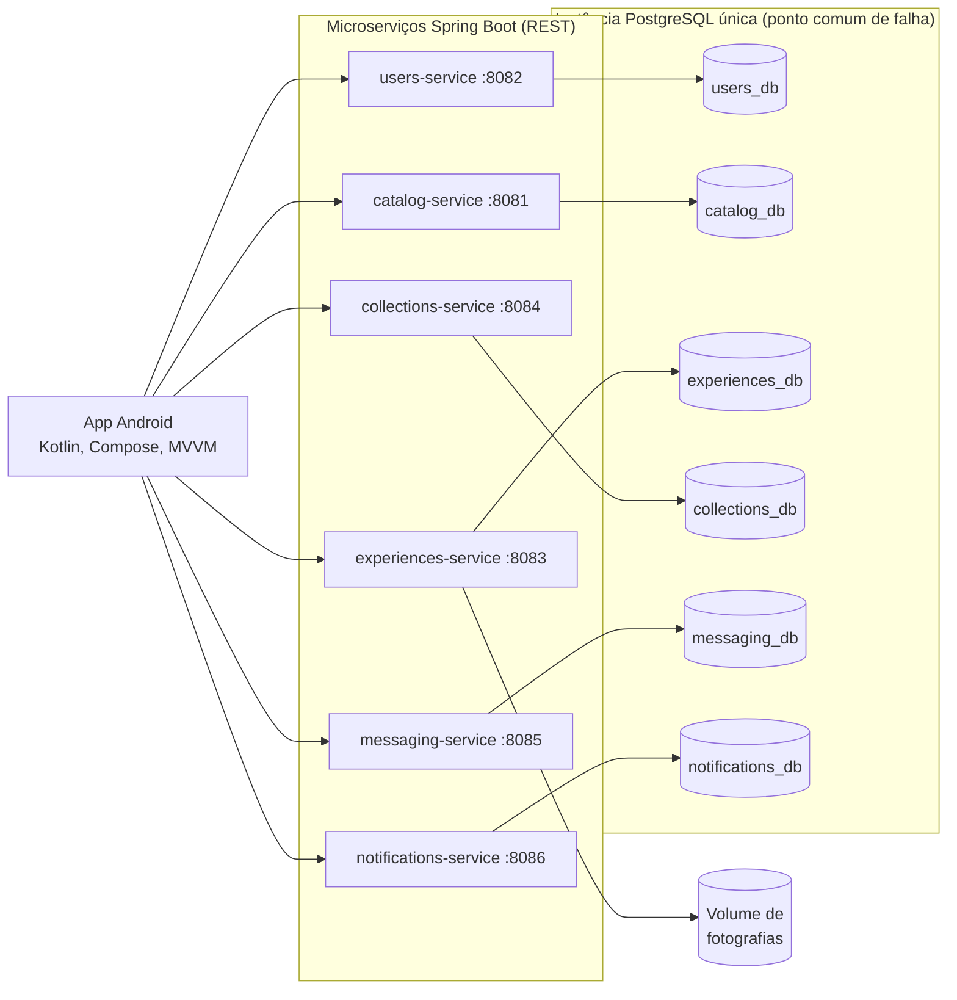

As dependências entre serviços estão na figura seguinte. As linhas contínuas são pedidos REST síncronos; as tracejadas são eventos entregues de forma assíncrona (*transactional outbox*).

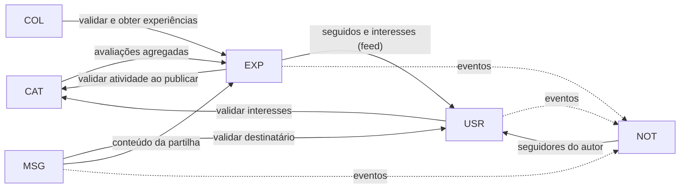

**Princípios:**

- **Isolamento dos dados:** nenhum serviço lê tabelas de outro. As referências entre serviços são identificadores estáveis, sem chaves estrangeiras entre bases.
- **Cópias de apresentação:** alguns dados são copiados no momento da escrita (por exemplo, o nome do local na experiência), para que se possam mostrar quando o serviço de origem falha. Identificam o que se mostra, nunca a quem pertencem os dados.
- **Métricas separadas:** as estrelas avaliam o local/atividade, os gostos e comentários avaliam a publicação, e as visualizações só servem as estatísticas do autor. Na avaliação geral, cada pessoa tem peso 1, e conta a sua experiência mais recente em cada atividade.

Desenho completo: [arquitetura.md](arquitetura.md).

**Tecnologias**, conforme os ficheiros de configuração do repositório:

| Componente | Versões |
|---|---|
| App | Kotlin 2.2.10, Android Gradle Plugin 9.4.1, Compose BOM 2026.02.01, Navigation Compose 2.10.2, Retrofit 3.0.0, OkHttp 4.12.0, kotlinx.serialization 1.9.0, Coil 3.3.0, WorkManager 2.11.2; `minSdk` 26, `targetSdk` 37 |
| Serviços | Kotlin 2.3.21, Spring Boot 4.1.1, JDK 25, Flyway, acesso por JDBC |
| Dados | PostgreSQL 18.6 |

---

## 4. Aplicação Android

### 4.1 Organização

A app é um único módulo, em Kotlin, com Jetpack Compose e Material 3. O código organiza-se por camadas e, na interface, por funcionalidade:

```
com.example.portofit/
├── MainActivity.kt, PortoFitApplication.kt
├── di/            AppContainer (injeção manual) e clientes HTTP
├── data/
│   ├── auth/      sessão: SessionManager, SessionStore
│   ├── location/  LocationProvider
│   ├── photo/     preparação das fotografias
│   ├── model/     modelos usados pela interface
│   ├── remote/    APIs Retrofit, DTO e conversões, por serviço
│   └── repository/ um repositório por área, com erros tipificados
├── notifications/ WorkManager, notificações do sistema, toque
└── ui/
    ├── components/ estados e componentes partilhados
    ├── navigation/ PortoFitNavHost
    ├── theme/
    └── feature/    auth, collections, discover, experience, messaging,
                    notifications, people, place, profile, search, stats
```

### 4.2 MVVM e gestão de estado

- **View (Compose):** desenha o estado e envia eventos. O estado é recolhido com `collectAsStateWithLifecycle`, só enquanto o ecrã está visível.
- **ViewModel:** expõe `StateFlow` com o estado do ecrã, muitas vezes com um estado por secção (a carregar, dados, vazio, erro). Assim, a falha de uma secção não esconde as outras.
- **Repository:** chama a API e classifica os erros (por exemplo, sem ligação, serviço indisponível, não encontrado).
- **Modelos:** os DTO da rede ficam separados dos modelos da interface.

Regras de estado com efeito visível:

- **Recriação da Activity e do processo:** o texto de pesquisa, os rascunhos e as chaves de idempotência das publicações ficam em `SavedStateHandle`.
- **Respostas antigas:** os pedidos em curso são cancelados ou ignorados quando o contexto muda.
- **Pesquisa:** cada modo (Locais, Experiências, Pessoas) tem ViewModel, texto, resultados e posição próprios. Só o modo em uso faz pedidos: não há pesquisa unificada.
- **Troca de conta:** os ecrãs com dados privados observam a identidade da sessão. Quando muda, apagam o estado e invalidam os pedidos em curso.
- **Consultas periódicas com o ecrã aberto:** conversa de 10 em 10 s; caixas de mensagens e de notificações de 30 em 30 s.

### 4.3 Navegação

Há um único `NavHost`, com uma barra inferior de três destinos que guardam o próprio estado: **Pesquisar** (inicial), **Descobrir** e **Estatísticas**. Os restantes ecrãs empilham-se por cima: detalhe do local, publicar ou editar, detalhe da experiência, perfil, perfil público, seguidores e seguidos, listas, guardar numa lista, mensagens, conversa, partilha, notificações, entrar e criar conta. O perfil, as listas, as mensagens e as notificações abrem-se pelo menu da conta, na barra superior.

Detalhe do comportamento e das verificações: [app-android.md](app-android.md).

---

## 5. Serviços

Em todos os serviços: o caminho base é `/api/v1`, os erros usam `application/problem+json` com um código estável, e a saúde responde em `/actuator/health`. Os endpoints abaixo são os principais; os contratos completos estão ligados em cada serviço. Os endpoints `/internal` exigem uma chave própria de cada relação entre serviços.

### 5.1 users-service

**Responsabilidades:** registo, autenticação, emissão de tokens, perfis, interesses e relações de seguir. Contrato: [users-api.md](users-api.md).

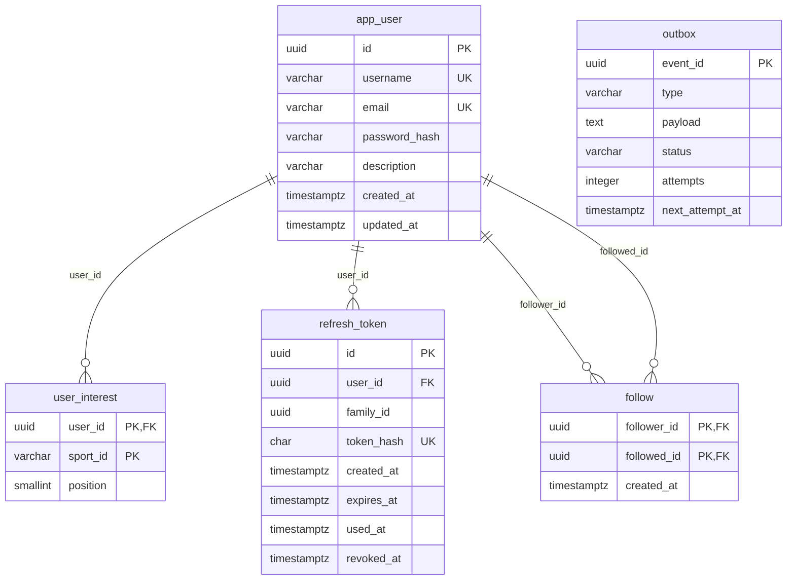

Fonte: migrações `V1` a `V3` do users-service. `user_interest.sport_id` refere o catálogo por id, sem chave estrangeira entre bases. `outbox` não tem relações: guarda os eventos a enviar às notificações.

| Endpoints | Descrição |
|---|---|
| `POST /auth/register`, `/login`, `/refresh`, `/logout` | Conta e sessão |
| `GET`, `PATCH /me`; `PUT /me/interests` | O meu perfil |
| `GET /users`, `GET /users/{id}` | Pesquisa e perfil público |
| `PUT`, `DELETE /users/{id}/follow`; `GET …/followers`, `…/following` | Seguir e listas |
| `GET /internal/me/feed-context`, `/internal/users/{id}/followers` | Para os feeds e as notificações |

**Interfaces:** valida as modalidades dos interesses em `GET /sports` do catálogo; envia `USER_FOLLOWED` ao notifications-service.

### 5.2 catalog-service

**Responsabilidades:** modalidades, locais, atividades e pesquisa por texto, modalidade e proximidade. Só leitura pela API. Contrato: [catalog-api.md](catalog-api.md).

| Entidade | Campos principais | Relações |
|---|---|---|
| `sport` | id (slug), name, description | 1:N com `activity_offering` |
| `place` | id, name, description, street, postal_code (opcional), parish (opcional), city, latitude, longitude, phone, website, is_demo, status | 1:N com `activity_offering` |
| `activity_offering` | id, place_id, sport_id, name, description, level, schedule_notes, status | N:1 com `place` e com `sport` |

| Endpoints | Descrição |
|---|---|
| `GET /sports` | Modalidades |
| `GET /places` | Pesquisa (`q`, `sport`, `lat`, `lng`, `radiusKm`, ordenação, paginação) |
| `GET /places/{id}` | Detalhe, com atividades e avaliações |
| `GET /offerings/{id}` | Atividade isolada |

**Interfaces:** pede as avaliações agregadas ao experiences-service, como complemento. Sem resposta, a avaliação fica "indisponível", nunca zero. Os dados reais vêm do importador (secção 12).

### 5.3 experiences-service

**Responsabilidades:** experiências, fotografias, avaliações agregadas, comentários, gostos, visualizações, feeds e estatísticas. Contrato: [experiences-api.md](experiences-api.md).

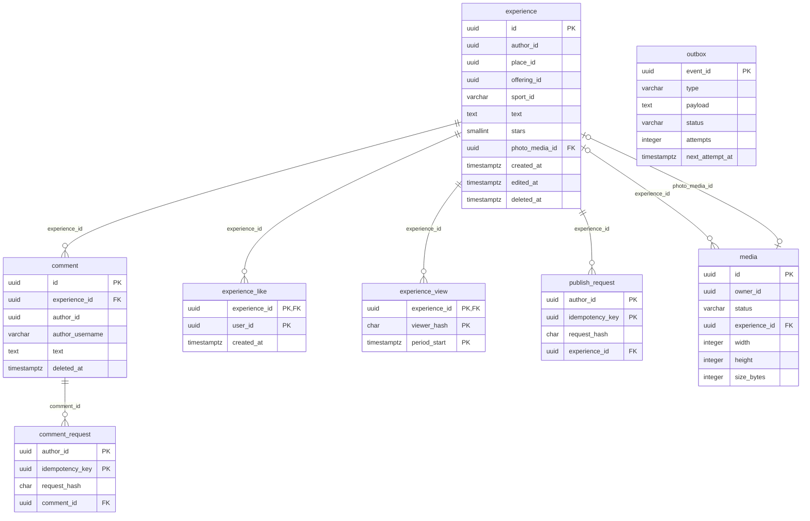

Fonte: migrações `V1` a `V4` do experiences-service. O diagrama mostra os campos principais e omite as cópias de apresentação de `experience` (nomes do autor, do local, da atividade e da modalidade, e a indicação de local fictício).

- **Referências externas:** `author_id`, `user_id`, `owner_id`, `place_id`, `offering_id` e `sport_id` referem outros serviços por id, sem chaves estrangeiras entre bases.
- **Fotografia:** o ficheiro fica no volume. `photo_media_id` é único quando preenchido, por isso cada experiência tem no máximo uma fotografia atual.
- **Visualizações:** no máximo uma por pessoa ou instalação em cada período (dia UTC); só se guarda um hash.
- **Idempotência:** `publish_request` e `comment_request` evitam duplicados em repetições.
- **`outbox`:** não tem relações; guarda os eventos a enviar às notificações.

| Endpoints | Descrição |
|---|---|
| `GET`, `POST /experiences`; `GET`, `PATCH`, `DELETE /experiences/{id}` | Consultar (filtros, `q`, `sort`), publicar, editar, eliminar |
| `POST /media`, `GET /media/{id}` | Enviar e obter fotografias |
| `GET`, `POST /experiences/{id}/comments`; `PATCH`, `DELETE /comments/{id}` | Comentários |
| `PUT`, `DELETE /experiences/{id}/like`; `POST …/views` | Gostos e visualizações |
| `GET /feed/popular`, `GET /feed` | Feeds |
| `GET /me/stats`, `GET /me/stats/experiences` | Estatísticas do próprio |
| `GET /ratings/places` | Avaliações agregadas |
| `GET /internal/experiences` | Consulta em lote para as listas e as mensagens |

**Interfaces:** valida a atividade no catálogo ao publicar, guardando a validação em memória durante 10 minutos (secção 10); pede o contexto do feed ao users-service; envia `COMMENT_CREATED` e `EXPERIENCE_PUBLISHED` ao notifications-service.

### 5.4 collections-service

**Responsabilidades:** listas pessoais e referências às experiências guardadas. As listas são privadas. Contrato: [collections-api.md](collections-api.md).

| Entidade | Campos principais | Relações |
|---|---|---|
| `collection` | id, owner_id, name | 1:N com `collection_item` |
| `collection_item` | collection_id, experience_id, added_at | referência à experiência por id |
| `collection_request` | owner_id, idempotency_key, request_hash, collection_id | evita duplicados na criação |

| Endpoints | Descrição |
|---|---|
| `GET`, `POST /collections`; `GET`, `PATCH`, `DELETE /collections/{id}` | Listas |
| `GET /collections/{id}/items` | Itens, cada um com `AVAILABLE`, `DELETED` ou `UNKNOWN` |
| `PUT`, `DELETE /collections/{id}/items/{experienceId}` | Guardar e remover |

**Interfaces:** consulta o experiences-service em lote. Sem resposta, os itens ficam `UNKNOWN`, e não "eliminados".

### 5.5 messaging-service

**Responsabilidades:** conversas 1-para-1, mensagens de texto e partilha de experiências. A app obtém as mensagens novas por consulta periódica; não há tempo real. Contrato: [messaging-api.md](messaging-api.md).

| Entidade | Campos principais | Relações |
|---|---|---|
| `conversation` | id, user_low, user_high, cópias dos usernames, last_seq, message_count | única por par de pessoas |
| `conversation_member` | user_id, conversation_id, last_read_seq | estado de leitura de cada pessoa |
| `message` | conversation_id, seq, id, sender_id, text, experience_id, idempotency_key | N:1 com `conversation`; `seq` crescente na conversa |
| `outbox` | como no users-service | eventos para as notificações |

| Endpoints | Descrição |
|---|---|
| `GET`, `POST /conversations`; `GET /conversations/{id}` | Caixa, abrir, consultar |
| `GET`, `POST /conversations/{id}/messages` | Histórico e novas (`before`, `after`), enviar |
| `PUT /conversations/{id}/read` | Marcar como lida |
| `GET /conversations/{id}/shares` | Atualizar o estado das partilhas |

**Interfaces:** valida o destinatário no users-service; obtém o conteúdo das partilhas no experiences-service; envia `MESSAGE_RECEIVED` ao notifications-service.

### 5.6 notifications-service

**Responsabilidades:** receber eventos, guardar a caixa privada de cada pessoa e responder às consultas. Não guarda o texto de mensagens nem de comentários: o texto visível é construído na app. Contrato: [notifications-api.md](notifications-api.md).

| Entidade | Campos principais | Relações |
|---|---|---|
| `inbox` | recipient_id, last_seq | numeração por pessoa |
| `notification` | id, recipient_id, seq, type, actor_id, actor_username, ids dos objetos, read_at | N:1 lógica com `inbox` |
| `received_event` | event_id, producer, type, payload_hash | deduplicação |
| `fan_out_job` | event_id, actor_id, experience_id, status, cursor, attempts | resolução paginada dos seguidores |

| Endpoints | Descrição |
|---|---|
| `GET /notifications`; `GET /notifications/unread-count` | Caixa e contagem por ler |
| `PUT /notifications/{id}/read`; `PUT /notifications/read` | Marcar uma ou todas |
| `POST /internal/events` | Receção de eventos, com uma chave por produtor |

**Interfaces:** recebe eventos do users, experiences e messaging; pede ao users-service os seguidores do autor de uma nova experiência.

**Entrega dos eventos:** cada produtor grava o evento na **mesma transação** da ação, numa tabela `outbox`, e uma tarefa agendada envia-o, com novas tentativas a intervalos crescentes. O destino elimina duplicados. Um evento que esgote as tentativas fica `FAILED` e guardado. A entrega é "pelo menos uma vez" enquanto o evento estiver pendente, sem garantia absoluta.

---

## 6. Funcionalidades e interfaces da aplicação

> **Origem das capturas:** app real no emulador (Pixel 9, Android 17), a 2026-11-05, com os seis serviços em execução e o catálogo real. As experiências, comentários, gostos, a lista, a conversa e as notificações foram criados para as capturas com três contas temporárias (`relatorio.ana`, `relatorio.rui` e `relatorio.sara`). Não são opiniões reais sobre os locais, e as avaliações que aparecem nos locais resultam desses dados. A fotografia foi tirada com a câmara emulada, que mostra uma cena virtual. A figura 1 usa uma localização simulada no Porto.

### 6.1 Pesquisa

O ecrã tem três modos independentes: Locais, Experiências e Pessoas.

**Locais:** pesquisa por texto, sem distinguir maiúsculas nem acentos, filtro por modalidade e proximidade opcional. Cada cartão mostra o nome, as modalidades em etiquetas, a localização, a distância (quando há) e a avaliação. "Sem avaliações" e "Avaliações temporariamente indisponíveis" são estados diferentes. As mensagens de lista vazia distinguem uma pesquisa sem correspondência de uma modalidade ainda sem locais.

<p align="center">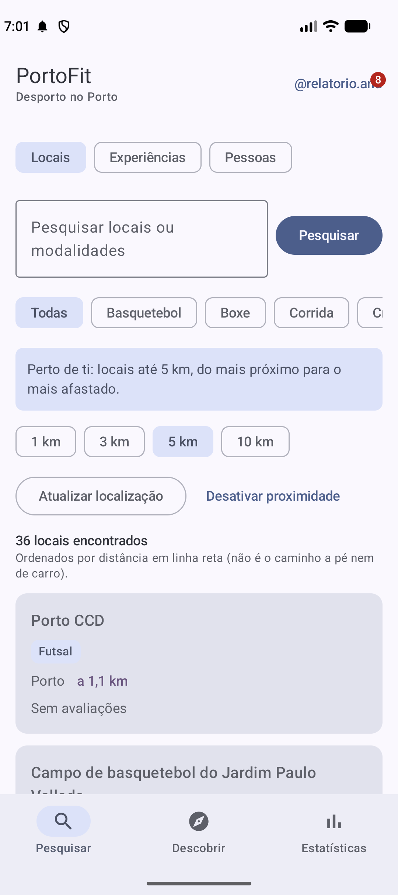</p>

<p align="center"><em>Figura 1 — Pesquisa de locais reais por proximidade, com a distância em cada cartão.</em></p>

**Experiências:** pesquisa no texto da experiência e no nome do local, da atividade e da modalidade, com submissão explícita (2 a 100 caracteres), as quatro ordenações e "Carregar mais". O cartão abre o detalhe, e `@autor` abre o perfil.

**Pessoas:** pesquisa por nome de utilizador.

<p align="center">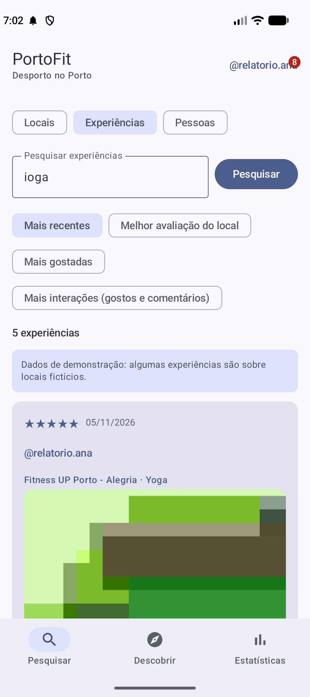 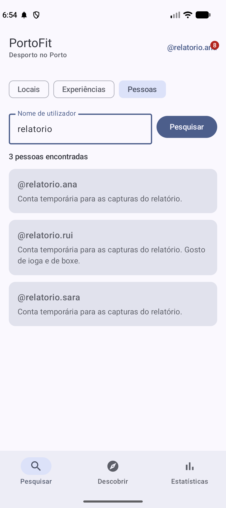</p>

<p align="center"><em>Figura 2 — Modos Experiências (à esquerda, com as ordenações) e Pessoas (à direita).</em></p>

### 6.2 Detalhe do local

Morada, contactos, modalidades, atividades (com o tipo de acesso e "Nível não indicado") e experiências ordenáveis. As ações "Ver no mapa", "Telefonar" e "Abrir site" só aparecem com dados válidos, e abrem outras aplicações. O telefone abre o marcador, sem iniciar a chamada.

<p align="center">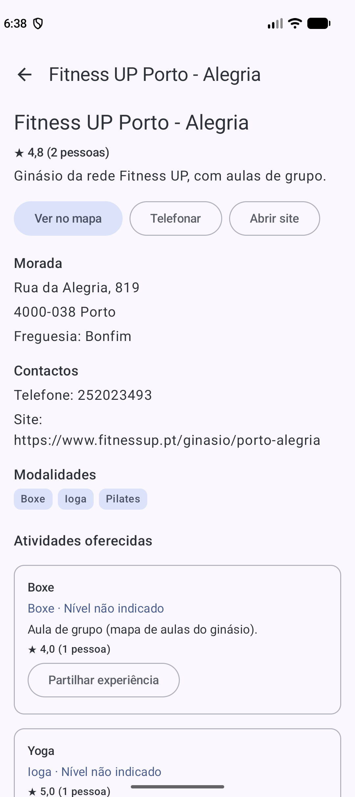</p>

<p align="center"><em>Figura 3 — Detalhe de um local real, com as ações, a morada, os contactos e as atividades.</em></p>

### 6.3 Publicar uma experiência

A partir de uma atividade: texto, estrelas e fotografia opcional, tirada com a câmara ou escolhida na galeria. A própria experiência pode ser editada e eliminada.

<p align="center">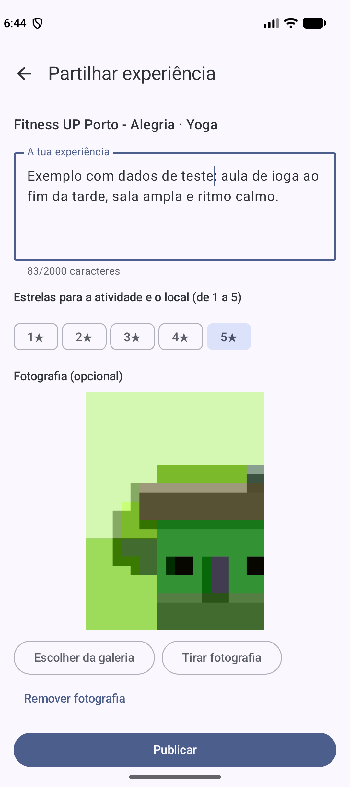</p>

<p align="center"><em>Figura 4 — Publicação de uma experiência, com estrelas e fotografia da câmara.</em></p>

### 6.4 Interações

Comentar, gostar, guardar numa lista e partilhar com outra pessoa.

<p align="center">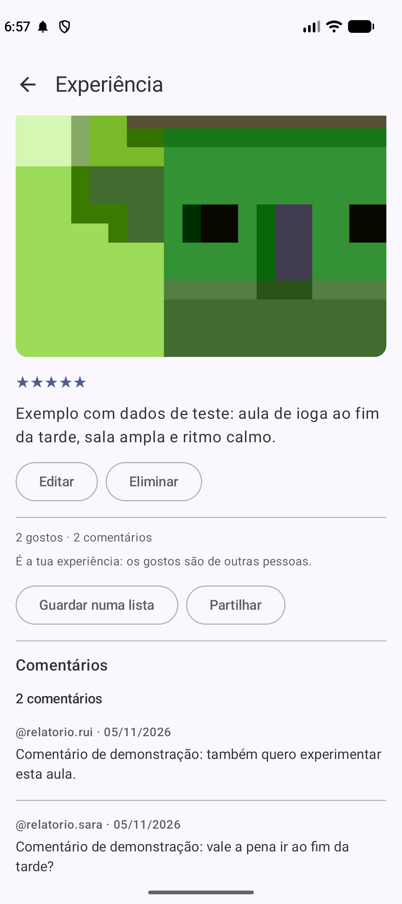</p>

<p align="center"><em>Figura 5 — Detalhe da experiência publicada, com gostos, comentários e ações.</em></p>

### 6.5 Descobrir

Sem sessão, feed **Populares**. Com sessão, também **Para ti**. Ambos têm filtro por modalidade. O ecrã indica quando mostra populares por não conseguir personalizar.

<p align="center">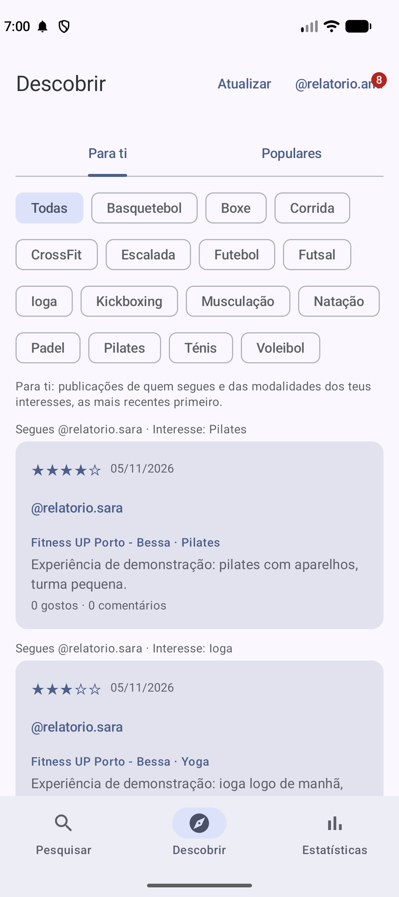</p>

<p align="center"><em>Figura 6 — Descobrir: feed Para ti, com o motivo de cada publicação.</em></p>

### 6.6 Estatísticas

Totais recebidos, valores por publicação e períodos "Sempre", 7 e 30 dias, em dias UTC. O histograma mostra as estrelas que o próprio autor deu aos locais/atividades, e não notas recebidas pela publicação. Sem sessão, aparece um convite para entrar.

<p align="center">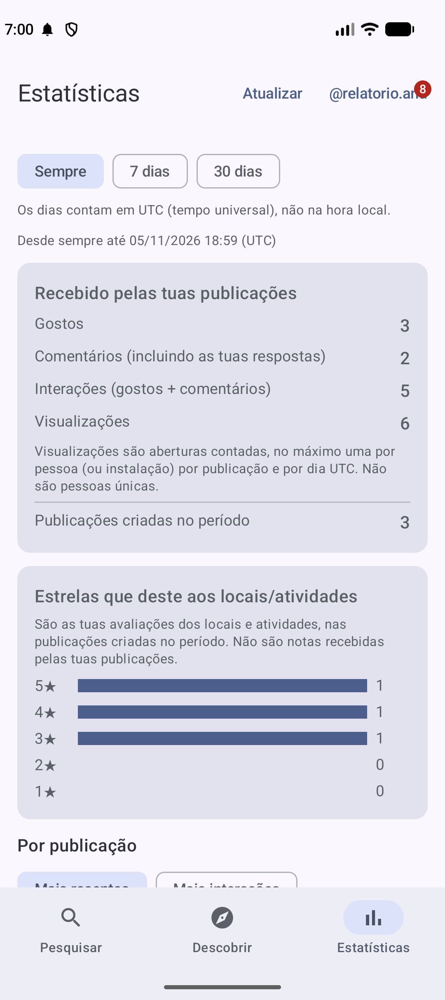</p>

<p align="center"><em>Figura 7 — Estatísticas do autor: totais recebidos e histograma das estrelas dadas.</em></p>

### 6.7 Perfil e pessoas

Perfil com descrição, interesses e publicações; perfil público com seguir, seguidores e seguidos, e início de conversa.

<p align="center">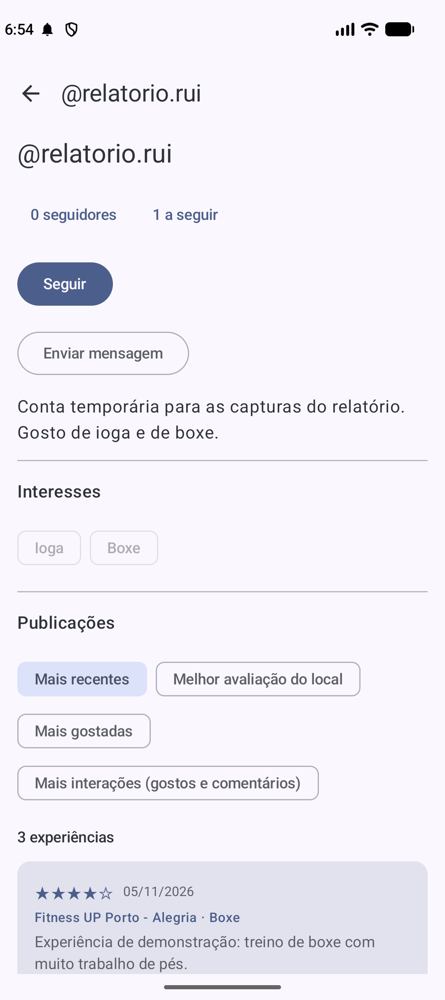</p>

<p align="center"><em>Figura 8 — Perfil público, com seguir, mensagem, descrição, interesses e publicações.</em></p>

### 6.8 Listas

<p align="center"></p>

<p align="center"><em>Figura 9 — Lista pessoal com experiências guardadas.</em></p>

### 6.9 Mensagens e partilha

<p align="center">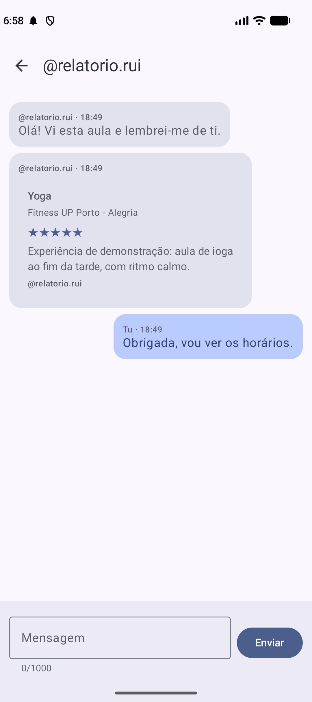</p>

<p align="center"><em>Figura 10 — Conversa com uma experiência partilhada.</em></p>

### 6.10 Notificações

Caixa privada, com marcação como lida e abertura do destino.

<p align="center"></p>

<p align="center"><em>Figura 11 — Caixa de notificações na app.</em></p>

<p align="center">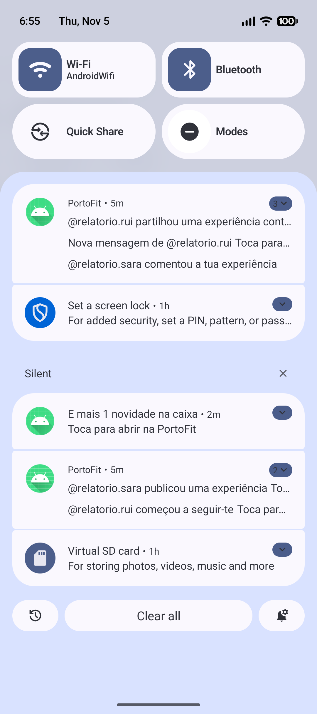</p>

<p align="center"><em>Figura 12 — Notificações do sistema criadas pela consulta periódica do WorkManager.</em></p>

### 6.11 Conta

Registo, entrada e saída da conta. As regras estão na secção 8.

---

## 7. Câmara, galeria e localização

| Recurso | Como é usado | Permissão |
|---|---|---|
| **Câmara** | A aplicação de câmara do sistema é aberta a partir do ecrã de publicação (`TakePicture`, com um `FileProvider`). Sem aplicação de câmara, a galeria e a publicação sem fotografia continuam disponíveis | Nenhuma: não usa `CAMERA` |
| **Galeria** | Android Photo Picker | Nenhuma permissão de armazenamento |
| **Localização** | Só depois de tocar em "Usar a minha localização". Aceita localização aproximada. Prazo de 15 s; posições com mais de 10 minutos são recusadas; raios de 1, 3, 5 e 10 km | `ACCESS_COARSE_LOCATION` e `ACCESS_FINE_LOCATION`, pedidas nesse momento |
| **Notificações** | Pedida a partir de um cartão explicativo, nunca ao abrir a app | `POST_NOTIFICATIONS` (Android 13+) |

**Fotografias:** a app corrige a orientação e reduz a imagem (lado maior até 1600 px, JPEG). No servidor, a imagem é validada pelo conteúdo e recodificada, e os metadados são removidos, incluindo a localização GPS. Cada experiência tem no máximo uma fotografia.

**Localização:** as coordenadas ficam só em memória, enquanto a pesquisa está ativa. Não são guardadas nem associadas às publicações, e não há seguimento em segundo plano. Se a localização falhar, a pesquisa por texto e por modalidade continua.

**Ambiente de verificação:** estes percursos foram verificados **no emulador** (Pixel 9, Android 17), com câmara emulada e localização simulada. **Não houve testes em telemóvel físico**, por isso continuam por verificar a orientação de uma fotografia de uma câmara real e o GPS real.

---

## 8. Autenticação, autorização e privacidade

- **Autenticação:** login por email e palavra-passe, guardada com hash BCrypt. O users-service emite um **access token** JWT (RS256) de 15 minutos e um **refresh token** opaco, com rotação a cada uso e prazo máximo de 30 dias. A reutilização de um refresh token revoga a sessão. O logout revoga o refresh token.
- **Validação nos serviços:** cada serviço valida o JWT localmente com a chave pública (assinatura, emissor, destinatário e expiração), sem chamar o users-service em cada pedido. A chave privada só é montada no users-service.
- **Autorização:** a consulta de locais, experiências, comentários e perfis é pública; as escritas exigem sessão. A identidade vem sempre do token, nunca do corpo do pedido. Só o dono altera os seus conteúdos e acede às suas listas, conversas e notificações.
- **Na app:** o refresh token fica cifrado com AES-256-GCM, com uma chave do Android Keystore. O access token só existe em memória. A sessão fica fora das cópias de segurança do Android.
- **Minimização de dados:** a caixa de notificações não guarda texto de mensagens nem de comentários, e as notificações do sistema estão configuradas para mostrar uma versão genérica no ecrã bloqueado. As visualizações guardam apenas um hash, sem endereço IP.

**Limitações aceites nesta versão:** um access token continua válido até expirar, mesmo depois do logout. Em desenvolvimento, o tráfego é HTTP sem TLS, permitido apenas para os endereços locais na variante `debug`. A variante `release` não tem endereços configurados por omissão.

---

## 9. Docker Compose, persistência e configuração

**Composição (`docker-compose.yml`):** sete contentores: os seis serviços e o PostgreSQL. Cada serviço depende apenas do PostgreSQL para arrancar, por isso pode parar sem impedir o arranque dos outros. Todos têm verificação de saúde, limite de 512 MiB e reinício automático.

**PostgreSQL:** por decisão do grupo, existe **uma única instância**, num contentor, com **seis bases de dados e seis utilizadores com credenciais separadas**, criados por scripts de inicialização que retiram o acesso público a cada base. Cada serviço só recebe as credenciais da sua e obtém os dados de outro pela respetiva API.

O isolamento foi verificado com tentativas de acesso cruzado entre bases, recusadas nos pares testados. Cada serviço utiliza credenciais próprias.

Esta instância é um **ponto comum de falha**: se o contentor parar, todos os serviços perdem a persistência ao mesmo tempo, e a degradação graciosa da secção 10 não cobre este caso.

**Persistência:**

| Volume | Conteúdo |
|---|---|
| `postgres-data` | As seis bases |
| `experiences-media` | Ficheiros das fotografias |

**Esquema:** cada serviço gere o seu com migrações Flyway próprias, aplicadas no arranque.

**Rede:** o PostgreSQL não publica portas e está numa rede interna. Os serviços publicam as portas 8081 a 8086 só em `127.0.0.1`.

**Configuração:** as credenciais e chaves internas vêm de um ficheiro `.env`, e o par de chaves JWT de uma pasta `secrets/`. Nenhum é versionado; o repositório inclui `.env.example` e um script para gerar as chaves. Em desenvolvimento, a chave privada fica em disco sem cifra.

**Arranque:**

```powershell
docker compose up -d --wait
```

No emulador, a app chega ao computador por `10.0.2.2`. Passos completos: [infraestrutura.md](infraestrutura.md).

**Perfis do catálogo:** o ambiente normal usa os locais reais. Existe um ambiente de demonstração separado, com dados fictícios e volumes próprios (`docker-compose.demo.yml`).

---

## 10. Degradação graciosa

Regras de desenho: cada pedido tem prazo; uma falha afeta só a secção que depende desse serviço; a app distingue "sem dados" de "indisponível" e nunca mostra zeros em vez de uma falha; as notificações não bloqueiam a ação que as originou.

Exemplos **efetivamente verificados**, parando serviços com `docker compose stop`:

| Serviço parado | Resultado observado | Como e quando |
|---|---|---|
| collections, messaging e notifications em simultâneo | Pesquisar locais, consultar uma experiência, publicar sem fotografia, comentar e ver o feed popular responderam com sucesso. Ao voltar o notifications-service, o comentário feito durante a falha chegou à caixa (outbox) | Pedidos HTTP com contas temporárias, 2026-10-27 |
| experiences | Pesquisa de locais com "Avaliações temporariamente indisponíveis", não 0 estrelas. No detalhe do local, as atividades continuam visíveis e só a secção de experiências mostra erro. No perfil, só "Publicações" mostra erro | Emulador, 2026-10-19 |
| experiences | Na lista, o item aparece como temporariamente indisponível, não eliminado. Numa conversa, a partilha aparece como indisponível, com o texto da mensagem visível | Emulador, 2026-10-20 e 2026-10-22 |
| users | O feed "Para ti" passa a populares, com aviso. As Estatísticas continuam. A pesquisa de locais continua, com aviso na pesquisa de pessoas | Emulador, 2026-10-18 a 2026-10-20 |
| users | Ao reabrir a app, a sessão mantém-se, com aviso de que não foi possível confirmá-la | Emulador, 2026-10-18 |
| catalog | Pesquisa de locais com "Sem ligação ao servidor…" e **Tentar novamente**, mantendo o texto e o filtro; depois de arrancar o serviço, os resultados voltam | Emulador, etapa 4 (2026-10-16) |
| messaging | Ao enviar: "Não foi possível confirmar se a mensagem foi enviada", com o rascunho mantido | Emulador, 2026-10-22 |

**Limites:**

- **PostgreSQL:** é o ponto comum de falha (secção 9).
- **users-service:** um token válido mantém algumas escritas até expirar; depois, sem o users-service, não é possível renovar a sessão.
- **catalog-service:** com ele parado, a publicação funciona numa atividade validada nos últimos 10 minutos, porque o experiences-service guarda essa validação em memória (a memória perde-se se este serviço reiniciar). Sem validação válida em memória, a publicação falha temporariamente com `503 CATALOG_UNAVAILABLE`: nada é criado, e a app mantém o formulário e indica a indisponibilidade. Ler experiências continua a funcionar. Resultados por pedidos HTTP: [experiences-api.md §20](experiences-api.md#20-estado-da-implementação).
- **Na interface:** parar o notifications-service com a app em uso só foi coberto no backend e por testes JVM.

---

## 11. Estratégia de testes e resultados confirmados

### 11.1 Níveis de teste

- **Serviços:** testes de integração com PostgreSQL 18.6 real (Testcontainers) e serviços vizinhos falsos, cobrindo contrato, validações, autorização e falhas.
- **App:** testes JVM de ViewModels, repositórios, conversões e regras puras. A interface foi verificada manualmente no emulador.
- **Pedidos HTTP:** percursos completos no ambiente Docker, com contas temporárias removidas no fim.
- **Verificação manual:** percursos no **emulador** (Pixel 9, Android 17). **Não houve testes em telemóvel físico.**
- **Análise estática:** `lintDebug`.

### 11.2 Execução final (2026-11-05)

Todos os módulos foram executados sequencialmente sobre o código atual, a 2026-11-05, com o emulador fechado. Os resultados de testes anteriores foram apagados antes de cada execução (`cleanTest`), por isso todos os testes correram de novo. Os serviços usaram PostgreSQL 18.6 real através do Testcontainers.

| Módulo | Comando | Resultado |
|---|---|---|
| catalog-service | `.\gradlew.bat cleanTest test` | 35 testes, 0 falhas, 0 ignorados |
| users-service | `.\gradlew.bat cleanTest test` | 29 testes, 0 falhas, 0 ignorados |
| experiences-service | `.\gradlew.bat cleanTest test` | 50 testes, 0 falhas, 0 ignorados |
| collections-service | `.\gradlew.bat cleanTest test` | 9 testes, 0 falhas, 0 ignorados |
| messaging-service | `.\gradlew.bat cleanTest test` | 27 testes, 0 falhas, 0 ignorados |
| notifications-service | `.\gradlew.bat cleanTest test` | 17 testes, 0 falhas, 0 ignorados |
| App (JVM) | `.\gradlew.bat :app:cleanTestDebugUnitTest :app:testDebugUnitTest` | 328 testes, 0 falhas, 0 ignorados |
| App (compilação) | `.\gradlew.bat :app:assembleDebug` | Concluída |
| App (análise estática) | `.\gradlew.bat :app:lintAnalyzeDebug --rerun :app:lintDebug` | 0 erros, 30 avisos |

**Total:** 495 testes automáticos, 0 falhas: 167 nos serviços e 328 na app.

**Avisos do lint:** 30 avisos relativos a versões de dependências, recursos não usados, plurais, ortografia e recomendações de API; nenhum erro.

O único teste instrumentado (`ExampleInstrumentedTest`, do modelo do projeto) não foi executado, porque exige o emulador.

### 11.3 Verificações por pedidos HTTP e na interface

**Percursos principais (2026-10-27):** com contas temporárias, sobre um local real: publicar com fotografia, editar, eliminar; guardar, comentar, gostar e partilhar; feeds, estatísticas e notificações; login, renovação, reutilização de token e logout; e serviços parados (secção 10). No fim, as contagens de todas as tabelas e os ficheiros do volume coincidiam com os de antes. Registo: [app-android.md §22](app-android.md#22-revisão-de-fecho-2026-10-27).

**Pesquisa de experiências (2026-11-04):** por pedidos HTTP, com contas temporárias removidas no fim: pesquisa sem sessão, sem distinguir acentos nem maiúsculas; pesquisa pelo nome do local; paginação e ordenação; limites de 2 e 100 caracteres (`400` fora deles). Depois, o funcionamento do modo Experiências foi confirmado manualmente no emulador. Registo: [app-android.md §24](app-android.md#24-pesquisa-de-experiências-2026-11-04).

**Recolha das capturas (2026-11-05):** no emulador, com contas temporárias, foram observados na interface os ecrãs das figuras 1 a 12. Entre eles:
- publicação com uma fotografia da câmara emulada;
- comentários, gostos, lista e conversa com partilha;
- feed "Para ti" e Estatísticas;
- notificações do sistema criadas pela consulta periódica do WorkManager.


---

## 12. Catálogo real

### 12.1 Fontes e critérios

Cada local foi procurado em fontes identificáveis: sites dos espaços, Ágora (empresa municipal do Porto), GO Porto, Visit Porto, Desporto365, CDUP, diretório de afiliados da CrossFit, Federação Portuguesa de Basquetebol, Associação de Voleibol do Porto e páginas dos espaços em plataformas de reservas. Os candidatos fora do município foram excluídos. As fontes estão no ficheiro de dados e em [locais-reais.md](locais-reais.md). As datas associadas a cada fonte (2026-10-27 ou 2026-10-28) são as da **primeira consulta registada**: foram reconstruídas pelo histórico dos commits, a partir do commit que acrescentou a fonte, e não são datas verificadas individualmente nas páginas.

Critérios principais:

- **Nível:** nenhuma fonte o indica de forma utilizável, por isso todas as atividades têm `UNSPECIFIED`, mostrado como "Nível não indicado".
- **Tipo de acesso:** aulas, aluguer, prática livre ou ponto de encontro de treino são identificados na atividade. Equipas de competição não contam como atividade aberta.
- **Modalidade:** não é atribuída a um pavilhão por parecer adequada; exige uma fonte que a ligue a esse pavilhão.
- **Campos opcionais:** ficam vazios quando não há fonte.
- **Coordenadas:** vêm de ligações de mapa oficiais, das páginas dos espaços ou de objetos do OpenStreetMap que correspondem ao espaço ou à morada confirmada. Algumas são aproximadas, o que está anotado no ficheiro de dados.

### 12.2 Importação repetível

O `RealPlacesImporter` lê `locais-reais-porto.json` em cada arranque com o perfil `real-places`:

- valida tudo antes de gravar, e um erro rejeita o ficheiro inteiro;
- usa identificadores fixos e `INSERT … ON CONFLICT DO UPDATE`, numa transação;
- só importa locais `ready` e atividades com acesso `CONFIRMED`;
- não apaga nada nem altera o estado de um registo já retirado.

Os locais fictícios usados no início do desenvolvimento estão `RETIRED` por migração, e não foram apagados porque há experiências antigas que os referem. Esses locais não aparecem na pesquisa de locais nem nos feeds. As experiências antigas sobre eles continuam acessíveis pelo perfil, por referência direta e pela pesquisa de experiências, onde o nome do local e um aviso os identificam como fictícios.

### 12.3 Situação atual

Contagens confirmadas no ficheiro de dados e, a 2026-10-28, pela API:

- **15 modalidades** (migrações V3 e V8);
- **48 entradas** no ficheiro: **39 locais importados**, com **74 atividades**, e **9 pendentes**;
- **5 locais importados sem código postal**, por não terem morada postal ou a fonte não o indicar.

| Modalidade | Locais ativos | | Modalidade | Locais ativos |
|---|---:|---|---|---:|
| Ioga | 13 | | Futebol | 4 |
| Pilates | 12 | | Futsal | 4 |
| Boxe | 6 | | Kickboxing | 4 |
| Basquetebol | 5 | | Padel | 3 |
| CrossFit | 5 | | Ténis | 3 |
| Musculação | 5 | | Voleibol | 3 |
| Natação | 5 | | Corrida | 2 |
| | | | Escalada | 0 |

Um local pode ter várias modalidades, por isso estes valores não se somam.

**Pendentes (9), com o motivo em `locais-reais.md`:** Piscina Armando Pimentel, São Rock, Skills Academy, Academia Marcial, Pavilhão do Viso, treinos de fim de semana da Porto Runners, Campo dos Choupos, Your Top-Padel Industrial e União Académica António Aroso.

**Limitações dos dados:**

- A lista municipal das tabelas de basquetebol é de 2022.
- A musculação nos ginásios Fitness UP vem de uma descrição da rede, não de cada clube.
- No Porto CCD, não se sabe se a reserva exige ser sócio.
- As modalidades abaixo de 5 locais refletem o que foi possível verificar, sem alargar a área nem inventar locais.

---

## 13. Limitações e trabalho futuro

### 13.1 Requisitos opcionais não implementados

Conteúdos offline, adaptação à ligação e adaptação de fidelidade.

### 13.2 Melhorias possíveis

- **Notificações imediatas:** a solução atual usa uma tarefa periódica do **WorkManager**, com intervalo mínimo de 15 minutos e atraso variável, que o Android pode adiar. Não é *push*. Firebase Cloud Messaging daria notificações quase imediatas, mas o enunciado não o exige.
- **Estatísticas:** número de vezes guardada; miniaturas de imagens.
- **Mensagens:** entrega em tempo real, em vez de consulta periódica.
- **Pesquisa:** sinónimos (por exemplo, "yoga" não encontra a modalidade "Ioga") e índice de texto para catálogos maiores.

### 13.3 Limitações técnicas

- HTTP sem TLS, só para desenvolvimento local; a variante `release` não está preparada para distribuição.
- Access tokens não revogáveis antes de expirar.
- Credenciais e chave privada adequadas apenas a desenvolvimento.
- A app só foi executada em emulador, com os serviços em ambiente local; não houve testes de carga.

---

## 14. Conclusão

O PortoFit implementa uma app Android em Kotlin e Compose, seis microserviços Spring Boot com dados e APIs próprios, integrados com Docker Compose, e um catálogo de locais reais do município do Porto. As funcionalidades implementadas foram avaliadas através de testes automáticos, pedidos HTTP e percursos manuais no emulador, conforme descrito na secção 11.

A execução final registou 495 testes automáticos sem falhas e uma análise de lint sem erros. A degradação graciosa foi verificada entre serviços aplicacionais.

### Referências

**Enunciado**

- "Practical assignment", V1.0, 6 de outubro. Programação de Dispositivos Móveis, FCUP.

**Documentação técnica do projeto**

- [Arquitetura](arquitetura.md)
- [Infraestrutura](infraestrutura.md)
- [App Android](app-android.md)
- Contratos: [users-service](users-api.md), [catalog-service](catalog-api.md), [experiences-service](experiences-api.md), [collections-service](collections-api.md), [messaging-service](messaging-api.md), [notifications-service](notifications-api.md)
- [Locais reais: fontes, critérios e datas](locais-reais.md)

**Dados**

- Fontes de cada local: `backend/catalog-service/src/main/resources/real/locais-reais-porto.json`
- Mapas: dados © colaboradores do OpenStreetMap, licença ODbL

**Documentação oficial das tecnologias** (páginas gerais, não específicas das versões da secção 3; endereços confirmados a 2026-11-04)

- Linguagem: [Kotlin](https://kotlinlang.org/docs/home.html), [Kotlin no Android](https://developer.android.com/kotlin), [kotlinx.serialization](https://kotlinlang.org/docs/serialization.html)
- Interface: [Jetpack Compose](https://developer.android.com/compose), [Material Design 3](https://m3.material.io/), [Navigation](https://developer.android.com/guide/navigation), [Coil](https://coil-kt.github.io/coil/)
- Arquitetura: [guia de arquitetura de apps Android](https://developer.android.com/topic/architecture)
- Rede: [Retrofit](https://github.com/square/retrofit), [OkHttp](https://github.com/square/okhttp)
- Trabalho em segundo plano e notificações: [WorkManager](https://developer.android.com/develop/background-work/background-tasks/persistent), [notificações](https://developer.android.com/develop/ui/views/notifications)
- Recursos do aparelho: [Photo Picker](https://developer.android.com/training/data-storage/shared/photopicker), [`TakePicture`](https://developer.android.com/reference/androidx/activity/result/contract/ActivityResultContracts.TakePicture), [localização](https://developer.android.com/training/location), [Android Keystore](https://developer.android.com/privacy-and-security/keystore)
- Serviços: [Spring Boot](https://docs.spring.io/spring-boot/index.html), [validação de JWT com Spring Security](https://docs.spring.io/spring-security/reference/servlet/oauth2/resource-server/jwt.html), [Flyway](https://documentation.red-gate.com/flyway), [Testcontainers](https://java.testcontainers.org/)
- Dados e contentores: [PostgreSQL 18](https://www.postgresql.org/docs/18/), [Docker Compose](https://docs.docker.com/compose/), [volumes Docker](https://docs.docker.com/engine/storage/volumes/)
- Diagramas: [diagramas de entidades e relações em Mermaid](https://mermaid.js.org/syntax/entityRelationshipDiagram.html)
